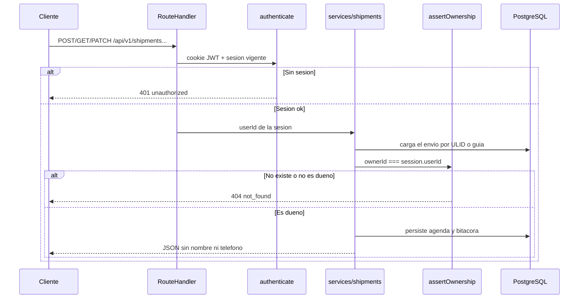

# Agenda de entregas (API, Phase 9)

Alcance acordado: **solo API** (más migración, servicios, pruebas y docs). El usuario **reclama** una guía existente con número + últimos 4 dígitos y luego agenda o reprograma; no crea envíos desde el cliente.

El dueño **nunca** viaja en el cuerpo ni en la URL: sale de `authenticate()`. Recurso ajeno o inexistente responde igual: **`404 not_found`** (no `403`), para no ser oráculo de IDOR. Sin sesión: **`401 unauthorized`**.

## Modelo de datos

Extender [`packages/database/src/schema.ts`](packages/database/src/schema.ts) y generar migración `0001` (no editar a mano la `0000`).

En `shipments`:

- `owner_id` (uuid, FK a `users`, nullable): `null` = sin reclamar (semilla actual).
- `public_id` (text unique): ULID Crockford de 26 caracteres, identificador de la API autenticada (no el UUID interno).
- `window_date` (date, nullable) y `window_slot` (text, nullable): franja elegida, p. ej. `08-10`.

Tablas nuevas:

- `shipment_audit_events`: `id`, `shipment_id`, `actor_user_id` (nullable), `type` (`claimed` | `scheduled` | `rescheduled` | `status_changed`), `from_status`, `to_status`, `created_at`. Sin IP, correo, guía ni nombre en claro. Índice `(shipment_id, created_at)` y `(actor_user_id, created_at)` para consulta por usuario. Retención documentada (p. ej. 365 días); sin job de purga en este sprint.
- `notifications`: `id`, `user_id`, `kind`, `body` (plantilla fija), `created_at`. El cuerpo **no** incluye guía, ULID, nombre, teléfono, dirección, ciudad ni franja.

Semilla: las guías `RS0000000001` / `RS0000000002` siguen **sin dueño**; al reclamar se asignan `owner_id` y, si falta, `public_id`.

**RLS (defensa en profundidad):** `ENABLE` + políticas `USING`/`WITH CHECK` sobre `owner_id = current_setting('app.user_id', true)::uuid`. Modos `public_tracking` y `claim` (solo en servicios de servidor, vía `SET LOCAL`) permiten el `SELECT` por guía y el `UPDATE` de reclamo cuando `owner_id IS NULL`. El control que cuenta en la API sigue siendo `assertOwnership`. El rol de Compose es dueño de las tablas (RLS no se aplica al owner sin `FORCE`); se documenta que en producción el runtime debe ser un rol no dueño. Las peticiones autenticadas igual harán `SET LOCAL app.user_id` en transacción.

## Contratos y errores

Nuevo [`packages/contracts/src/shipments.ts`](packages/contracts/src/shipments.ts), reexportado en el índice:

- Reutilizar `trackingRequestSchema` para el reclamo.
- `ulidSchema`, `deliverySlotSchema` (`08-10` | `10-12` | `12-14` | `14-16` | `16-18`), `scheduleRequestSchema` `{ date: YYYY-MM-DD, slot }` `.strict()`.
- Respuesta de envío autenticado: `id` (ULID), `trackingNumber`, `status`, `window` o `null`. **Sin** `recipientName` ni teléfono.
- Detalle: más `audit[]` (`type`, `fromStatus`, `toStatus`, `createdAt`).

Código nuevo `invalid_schedule` (400): franja inválida, fin de semana, pasado o envío ya no reprogramable (`delivered` / `out_for_delivery`). Mensaje fijo, sin distinguir causa interna.

## Autorización, franjas y notificaciones

- [`apps/rutasegura/src/server/authorization/ownership.ts`](apps/rutasegura/src/server/authorization/ownership.ts): `assertOwnership({ ownerId }, userId)` por igualdad exacta; `ownerId` null no es propio.
- [`apps/rutasegura/src/server/ids/ulid.ts`](apps/rutasegura/src/server/ids/ulid.ts): generación con `crypto` (sin dependencia nueva) y validación.
- [`apps/rutasegura/src/server/services/schedule.ts`](apps/rutasegura/src/server/services/schedule.ts): calendario **America/Bogota**, lunes–viernes, las cinco franjas de 2 h, inicio de franja **estrictamente futuro**. El cliente envía `date` + `slot`, no instantes arbitrarios.
- [`apps/rutasegura/src/server/notifications/simulate.ts`](apps/rutasegura/src/server/notifications/simulate.ts): inserta fila + log `notification.enqueued` con `kind` y `userId`; plantilla: *“Hay una novedad en uno de tus envíos. Entra a RutaSegura para ver el detalle.”*
- [`apps/rutasegura/src/server/services/shipments.ts`](apps/rutasegura/src/server/services/shipments.ts) (toda la regla de negocio):
  - **Reclamo:** mismo coste que el rastreo (siempre HMAC). Guía inexistente, dígitos malos o **ya de otro usuario** → `null` (404). Ya propio → idempotente. Libre → `owner_id` + evento `claimed`.
  - **Listar / obtener:** filtro por dueño de sesión; GET por ULID ajeno → `null`.
  - **Agendar:** `assertOwnership` + validación de franja; `scheduled` o `rescheduled`; notificación simulada.
  - **`transitionShipmentStatus`:** actualiza estado, escribe `shipment_events` + `status_changed` + notificación. **No hay endpoint HTTP** para que el cliente cambie el estado logístico (eso sería de operador). Las pruebas de servicio cubren bitácora y aviso.

Rate limit: reclamo reutiliza `trackingRules`; listar/agendar, límite por usuario autenticado (HMAC del `userId`, no el id en claro).

Rutas (mismo patrón que [`auth/me/route.ts`](apps/rutasegura/src/app/api/v1/auth/me/route.ts) y tracking: `withErrorHandling`, Zod, `apiError`/`apiJson`):

| Método | Ruta | Efecto |
|--------|------|--------|
| `POST` | `/api/v1/shipments/claim` | Reclamar guía |
| `GET` | `/api/v1/shipments` | Solo envíos del usuario |
| `GET` | `/api/v1/shipments/[id]` | Detalle + bitácora si es dueño |
| `PATCH` | `/api/v1/shipments/[id]/schedule` | Crear o cambiar franja |

Repositorio [`shipments.ts`](apps/rutasegura/src/server/repositories/shipments.ts): consultas por `public_id` / guía, listado por `owner_id`, update de reclamo y de ventana. El rastreo público no cambia de contrato.

## Pruebas y docs

- Unitarias: franjas (válida, fin de semana, pasada, slot inventado); `assertOwnership`; cuerpo de notificación sin guía/nombre/teléfono; transiciones de estado escriben auditoría; contratos Zod `.strict()` rechazan `ownerId`/`userId`.
- Smoke en Docker (extender [`smoke/auth.smoke.test.ts`](apps/rutasegura/smoke/auth.smoke.test.ts) o archivo hermano): Alice reclama `RS0000000001` y agenda; Bob sobre el ULID de Alice → **404** en GET y PATCH; sin cookie → 401; lista de Alice no incluye la guía no reclamada.
- Documentar endpoints, errores y prueba negativa en [`docs/api.md`](docs/api.md); actualizar controles pendientes en [`docs/seguridad.md`](docs/seguridad.md) y [`docs/autenticacion.md`](docs/autenticacion.md); [`CHANGELOG.md`](CHANGELOG.md) en Unreleased.

No hay UI que verificar en el navegador; la evidencia será smoke/curl contra la API.