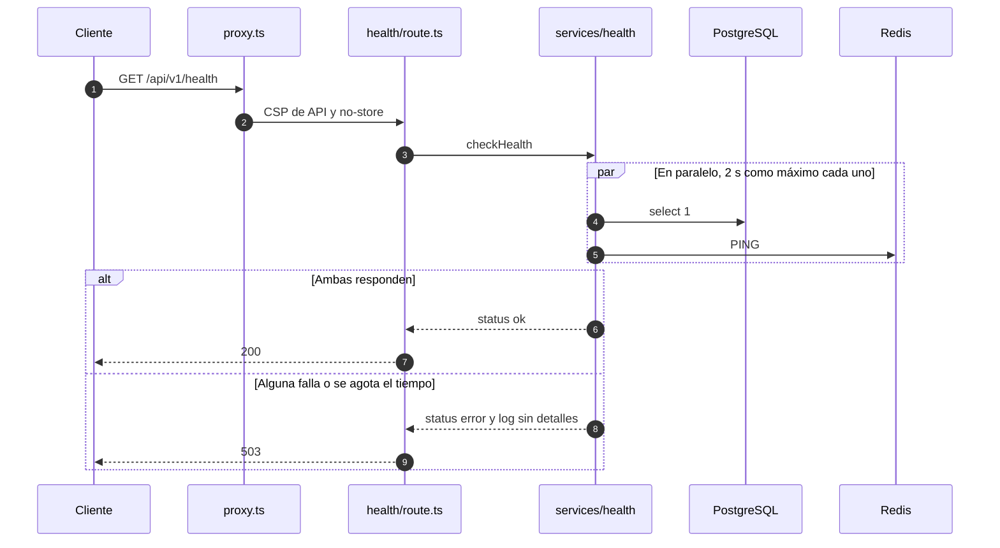

# API

La API vive bajo `/api/v1` en el mismo origen que la interfaz. La implementan Route Handlers de Next.js en [`apps/rutasegura/src/app/api`](../apps/rutasegura/src/app/api), y sus tipos y esquemas están en [`packages/contracts`](../packages/contracts/src).

## Convenciones

| Aspecto    | Regla                                                                                                                                    |
| ---------- | ---------------------------------------------------------------------------------------------------------------------------------------- |
| Versión    | Prefijo `/api/v1`. Un cambio incompatible abre `/api/v2`                                                                                 |
| Formato    | JSON en peticiones y respuestas                                                                                                          |
| Caché      | Toda respuesta de API lleva `Cache-Control: no-store`                                                                                    |
| CSP        | `default-src 'none'; frame-ancestors 'none'; base-uri 'none'; form-action 'none'`: una respuesta JSON nunca se interpreta como documento |
| Errores    | Cuerpo `{ "error": { "code", "message" } }` con un mensaje fijo por código                                                               |
| Identidad  | El servidor deriva el usuario de la sesión. Ningún endpoint acepta `userId`, `ownerId` ni roles en el cuerpo o la URL                    |
| Validación | Esquemas Zod en el servidor, siempre, aunque la UI ya haya validado                                                                      |

Además de lo anterior, cada respuesta lleva las cabeceras de seguridad comunes descritas en [seguridad.md](seguridad.md).

## Endpoints disponibles

### `GET /api/v1/health`

Comprueba PostgreSQL y Redis en paralelo, cada uno con un tiempo límite de 2 segundos. Lo usan el healthcheck de Docker Compose y cualquier monitor externo.

Todo en orden, `200`:

```json
{ "status": "ok", "checks": { "database": "ok", "redis": "ok" } }
```

Alguna dependencia falla o no responde a tiempo, `503`:

```json
{ "status": "error", "checks": { "database": "ok", "redis": "error" } }
```

La respuesta nunca incluye mensajes de error, cadenas de conexión ni versiones. El detalle queda en el log del servidor, reducido al tipo de error:

```json
{ "level": "error", "event": "health.dependency_failed", "dependency": "redis", "kind": "Error" }
```



### Autenticación

Todas las mutaciones exigen `Content-Type: application/json` (cuerpo de 16 KiB como máximo) y, si el navegador envía `Origin`, que sea el de la app; de lo contrario, `403 forbidden`. El diseño completo está en [autenticacion.md](autenticacion.md).

#### `POST /api/v1/auth/register`

```json
{ "email": "ana@example.org", "password": "caballo-bateria-grapa", "fullName": "Ana Pérez" }
```

| Respuesta | ¿Cuándo?                                                                         |
| --------- | -------------------------------------------------------------------------------- |
| `201`     | `{"status":"accepted"}`, tanto si la cuenta se creó como si el correo ya existía |
| `400`     | Cuerpo inválido, contraseña fuera de política o campos adicionales               |
| `429`     | Más de 5 registros por IP en una hora                                            |

#### `POST /api/v1/auth/login`

```json
{ "email": "ana@example.org", "password": "caballo-bateria-grapa" }
```

`200` con el usuario y dos cookies `HttpOnly; SameSite=Lax` (JWT de acceso y refresh token):

```json
{ "user": { "id": "…", "email": "ana@example.org", "fullName": "Ana Pérez", "role": "customer" } }
```

| Respuesta | ¿Cuándo?                                                                             |
| --------- | ------------------------------------------------------------------------------------ |
| `401`     | `invalid_credentials`: usuario inexistente, contraseña incorrecta o cuenta bloqueada |
| `429`     | Más de 10 intentos por IP o por correo en 15 min, con `Retry-After`                  |
| `503`     | Redis no disponible: el rate limit falla cerrado                                     |

#### `POST /api/v1/auth/refresh`

Sin cuerpo. Usa la cookie de refresh, la rota y emite cookies nuevas. `200` con el usuario, o `401` (y cookies borradas) si el token no existe, venció o ya se había rotado. Reutilizar un token rotado revoca todas las sesiones de ese login.

#### `POST /api/v1/auth/logout`

Sin cuerpo. Revoca la sesión y borra las cookies. Siempre `204`.

#### `GET /api/v1/auth/me`

Ruta protegida. `200 {"user": …}` con un JWT válido y una sesión vigente; `401 unauthorized` en cualquier otro caso (sin cookie, token alterado o vencido, sesión cerrada).

### `POST /api/v1/tracking`

Consulta pública de una guía con doble dato:

```json
{ "trackingNumber": "RS0000000001", "phoneLast4": "4321" }
```

`200`, solo con estado y recorrido:

```json
{
  "trackingNumber": "RS0000000001",
  "status": "in_transit",
  "events": [
    { "status": "created", "city": "Bogotá", "occurredAt": "2026-09-20T13:00:00.000Z" },
    { "status": "in_transit", "city": "Bogotá", "occurredAt": "2026-09-21T09:30:00.000Z" },
    { "status": "in_transit", "city": "Medellín", "occurredAt": "2026-09-22T07:15:00.000Z" }
  ]
}
```

| Respuesta | ¿Cuándo?                                                                     |
| --------- | ---------------------------------------------------------------------------- |
| `400`     | Guía fuera del formato `RS` más 10 dígitos, o dígitos que no sean 4          |
| `404`     | `tracking_not_found`: guía inexistente o dígitos incorrectos, sin distinción |
| `429`     | Más de 5 consultas por IP o por guía en 15 min                               |

La semilla de desarrollo crea, con datos ficticios y sin dueño, `RS0000000001` (dígitos `4321`, en tránsito, con dos documentos) y `RS0000000002` (dígitos `9876`, entregada). `RS0000000003` (`5555`) es de la prueba smoke de documentos, y `RS0000000004` (`1111`) y `RS0000000005` (`2222`), de los flujos E2E en Chromium y WebKit.

### Envíos y agenda

Endpoints autenticados de la Phase 9. El usuario **reclama** una guía existente con el mismo doble dato del rastreo y después agenda o reprograma su franja de entrega; el cliente no crea envíos. El diseño de autorización está en [seguridad.md](seguridad.md#autorización-por-objeto).

- El dueño sale siempre de la sesión (`authenticate()`), nunca del cuerpo ni de la URL. Los contratos son `.strict()`: un `ownerId` o `userId` en el cuerpo da `400 bad_request`.
- Los envíos se identifican con un **ULID** (`public_id`, 26 caracteres Crockford), no con el UUID interno.
- Sin sesión: `401 unauthorized`. Envío ajeno, inexistente o con un identificador mal formado: `404 not_found`, con el mismo cuerpo en los tres casos. Nunca `403`, para no confirmar que el recurso existe.
- Las respuestas nunca incluyen nombre ni teléfono del destinatario.

| Método   | Ruta                              | Efecto                             |
| -------- | --------------------------------- | ---------------------------------- |
| `POST`   | `/api/v1/shipments/claim`         | Vincula una guía a la cuenta       |
| `GET`    | `/api/v1/shipments`               | Lista solo los envíos del usuario  |
| `GET`    | `/api/v1/shipments/{id}`          | Detalle y bitácora si es el dueño  |
| `PATCH`  | `/api/v1/shipments/{id}/schedule` | Crea o cambia la franja de entrega |
| `DELETE` | `/api/v1/shipments/{id}/schedule` | Cancela la franja de entrega       |

No existe endpoint para que el cliente cambie el estado logístico: eso es una operación de operador (`transitionShipmentStatus` en el servidor).

#### `POST /api/v1/shipments/claim`

```json
{ "trackingNumber": "RS0000000001", "phoneLast4": "4321" }
```

`200` con el envío:

```json
{
  "id": "01K66Z8Q3W0V2R8E1XJ5N7C4TB",
  "trackingNumber": "RS0000000001",
  "status": "in_transit",
  "window": null
}
```

| Respuesta | ¿Cuándo?                                                                                 |
| --------- | ---------------------------------------------------------------------------------------- |
| `200`     | Guía libre (queda a nombre del usuario) o ya reclamada por él: el reclamo es idempotente |
| `400`     | Mismo formato que el rastreo                                                             |
| `401`     | Sin sesión                                                                               |
| `404`     | `not_found`: guía inexistente, dígitos incorrectos o guía ya reclamada por otro usuario  |
| `429`     | Comparte límites con el rastreo: 5 intentos por IP o por guía en 15 min                  |

El reclamo cuesta lo mismo que el rastreo (siempre se calcula el HMAC) y cada fallo queda como `tracking_failure` en `auth_events`, porque es otra forma de probar dígitos contra una guía.

#### `GET /api/v1/shipments`

`200 {"shipments": [ … ]}` con los envíos del usuario, del más reciente al más antiguo. Las guías sin reclamar nunca aparecen.

#### `GET /api/v1/shipments/{id}`

`200` con el envío y su bitácora:

```json
{
  "id": "01K66Z8Q3W0V2R8E1XJ5N7C4TB",
  "trackingNumber": "RS0000000001",
  "status": "in_transit",
  "window": { "date": "2026-10-01", "slot": "14-16" },
  "audit": [
    {
      "type": "claimed",
      "fromStatus": null,
      "toStatus": null,
      "createdAt": "2026-09-28T02:10:54.000Z"
    },
    {
      "type": "scheduled",
      "fromStatus": null,
      "toStatus": null,
      "createdAt": "2026-09-28T02:10:55.000Z"
    }
  ]
}
```

#### `PATCH /api/v1/shipments/{id}/schedule`

```json
{ "date": "2026-10-01", "slot": "14-16" }
```

`date` es una fecha de calendario en `America/Bogota` y `slot`, una de las cinco franjas de 2 h: `08-10`, `10-12`, `12-14`, `14-16` o `16-18`. El cliente no envía instantes arbitrarios. `200` con el envío actualizado; si la franja no cambia, responde igual sin escribir nada.

| Respuesta | Cuándo                                                                                                              |
| --------- | ------------------------------------------------------------------------------------------------------------------- |
| `400`     | `bad_request`: cuerpo mal formado, franja fuera de la lista o campos adicionales                                    |
| `400`     | `invalid_schedule`: sábado o domingo, franja que ya empezó o envío `out_for_delivery` o `delivered`, sin distinción |
| `401`     | Sin sesión                                                                                                          |
| `404`     | `not_found`: envío ajeno o inexistente                                                                              |
| `429`     | Más de 60 peticiones del usuario por minuto (compartido con listar y consultar)                                     |

Cada agenda o reprogramación deja un evento `scheduled` o `rescheduled` en la bitácora y un aviso simulado con cuerpo genérico, que el usuario consulta en [`GET /api/v1/notifications`](#notificaciones).

#### `DELETE /api/v1/shipments/{id}/schedule`

Sin cuerpo. Deja el envío sin franja (`"window": null`) y responde `200` con el envío actualizado. Si ya no tenía franja, responde igual sin escribir nada: la cancelación es idempotente.

```json
{
  "id": "01K66Z8Q3W0V2R8E1XJ5N7C4TB",
  "trackingNumber": "RS0000000001",
  "status": "in_transit",
  "window": null
}
```

| Respuesta | ¿Cuándo?                                                                                 |
| --------- | ---------------------------------------------------------------------------------------- |
| `200`     | Franja cancelada, o el envío ya no tenía franja                                          |
| `400`     | `invalid_schedule`: envío `out_for_delivery` o `delivered`, que ya no se puede tocar     |
| `401`     | Sin sesión                                                                               |
| `403`     | Petición desde otro origen, rechazada en `proxy.ts`                                      |
| `404`     | `not_found`: envío ajeno, inexistente o con ULID mal formado, con el mismo cuerpo        |
| `429`     | Más de 60 peticiones del usuario por minuto (compartido con listar, consultar y agendar) |

Cada cancelación real deja un evento `unscheduled` en la bitácora, con el usuario como actor y la hora del servidor, y un aviso `shipment_unscheduled` con el mismo cuerpo genérico. La repetición idempotente no deja ni evento ni aviso.

#### Prueba de autorización negativa

El smoke en Docker ([`auth.smoke.test.ts`](../apps/rutasegura/smoke/auth.smoke.test.ts)) la ejecuta en cada PR. A mano:

```bash
# Alice reclama y agenda; guarda el ULID que devuelve el reclamo.
curl -s -b alice.txt -H 'content-type: application/json' \
  -d '{"trackingNumber":"RS0000000001","phoneLast4":"4321"}' \
  http://localhost:3000/api/v1/shipments/claim

# Bob, con su propia sesión, sobre el ULID de Alice: 404, igual que un ULID inexistente.
curl -si -b bob.txt http://localhost:3000/api/v1/shipments/<ULID-de-Alice>
curl -si -b bob.txt -X PATCH -H 'content-type: application/json' \
  -d '{"date":"2026-10-01","slot":"08-10"}' \
  http://localhost:3000/api/v1/shipments/<ULID-de-Alice>/schedule
curl -si -b bob.txt -X DELETE \
  http://localhost:3000/api/v1/shipments/<ULID-de-Alice>/schedule

# Sin cookie: 401.
curl -si http://localhost:3000/api/v1/shipments
```

### Notificaciones

Avisos simulados del usuario de la sesión: se generan al agendar, al reprogramar, al cancelar la agenda y cuando un operador cambia el estado de un envío. La guía para conectarlos a la UI del portal está en [notificaciones.md](notificaciones.md).

- El usuario sale siempre de la sesión. No hay identificador de aviso ni de usuario en la URL, así que no hay objeto ajeno que pedir: cada consulta y cada marcado se filtran por el usuario de la sesión, con RLS como segunda capa.
- El cuerpo es una plantilla fija, sin guía, ULID, nombre, teléfono, dirección, ciudad ni franja.
- Sin sesión: `401 unauthorized`. Límite: 60 peticiones por minuto por usuario (`NOTIFICATIONS_RATE_LIMIT_*`), con `429` y `Retry-After`.

#### `GET /api/v1/notifications`

Parámetro opcional `?limit=` de 1 a 50 (20 por defecto). Cualquier otro parámetro, como `userId`, da `400 bad_request`.

`200`, del más reciente al más antiguo, con el total de no leídos:

```json
{
  "notifications": [
    {
      "kind": "shipment_rescheduled",
      "body": "Hay una novedad en uno de tus envíos. Entra a RutaSegura para ver el detalle.",
      "createdAt": "2026-09-28T02:47:58.000Z",
      "read": false
    }
  ],
  "unreadCount": 1
}
```

`kind` es `shipment_scheduled`, `shipment_rescheduled`, `shipment_unscheduled` o `shipment_status_changed`.

#### `POST /api/v1/notifications/read`

Sin cuerpo. Marca como leídos todos los avisos pendientes del usuario de la sesión y responde `200 {"unreadCount":0}`. Es idempotente.

#### Prueba de autorización negativa

El smoke en Docker la ejecuta en cada PR: Alice tiene 2 avisos por agendar y reprogramar; Bob lista 0, su `POST /read` no cambia el contador de Alice y `?userId=` responde 400. A mano:

```bash
curl -s -b bob.txt http://localhost:3000/api/v1/notifications        # {"notifications":[],"unreadCount":0}
curl -s -b bob.txt -X POST http://localhost:3000/api/v1/notifications/read
curl -s -b alice.txt http://localhost:3000/api/v1/notifications      # unreadCount sigue en 2
curl -si http://localhost:3000/api/v1/notifications                  # 401 sin cookie
```

### Documentos

Soportes de un envío en un bucket privado, descargables solo con una URL firmada de 60 s. Diseño, garantías y evidencia en [documentos.md](documentos.md).

- Mismas reglas que los envíos: dueño desde la sesión, ULID públicos, `401` sin sesión y el mismo `404 not_found` para lo ajeno, lo inexistente y lo mal formado.
- Las respuestas nunca incluyen la clave del objeto, el bucket ni el endpoint del almacenamiento.
- Límite: 30 peticiones por minuto por usuario (`DOCUMENTS_RATE_LIMIT_*`), compartido entre listar y emitir URLs, con `429` y `Retry-After`.

| Método | Ruta                                  | Efecto                                         |
| ------ | ------------------------------------- | ---------------------------------------------- |
| `GET`  | `/api/v1/shipments/{id}/documents`    | Lista los documentos de un envío propio        |
| `POST` | `/api/v1/documents/{id}/download-url` | Emite una URL firmada de descarga, válida 60 s |

#### `GET /api/v1/shipments/{id}/documents`

`200`, del más antiguo al más reciente:

```json
{
  "documents": [
    {
      "id": "01K7FQ2W3E4R5T6Y7U8I9O0P1A",
      "shipmentId": "01K66Z8Q3W0V2R8E1XJ5N7C4TB",
      "fileName": "Guía de transporte.pdf",
      "mimeType": "application/pdf",
      "sizeBytes": 589,
      "createdAt": "2026-10-13T21:58:04.000Z"
    }
  ]
}
```

#### `POST /api/v1/documents/{id}/download-url`

Sin cuerpo. `200` con `Cache-Control: no-store`:

```json
{
  "url": "http://localhost:9000/rutasegura-private/documents/n2b7v4c9x1z6m3q8?X-Amz-Algorithm=AWS4-HMAC-SHA256&…&X-Amz-Expires=60&X-Amz-Signature=…",
  "expiresAt": "2026-10-13T22:21:46.000Z",
  "expiresIn": 60
}
```

| Respuesta | ¿Cuándo?                                                                        |
| --------- | ------------------------------------------------------------------------------- |
| `200`     | Documento de un envío propio; queda un evento `document_url_issued`             |
| `401`     | Sin sesión                                                                      |
| `403`     | Petición desde otro origen, rechazada en `proxy.ts`                             |
| `404`     | `not_found`: documento ajeno, inexistente o con ULID mal formado                |
| `429`     | Más de 30 peticiones del usuario por minuto                                     |
| `503`     | `service_unavailable`: almacenamiento sin configurar (solo fuera de producción) |

La URL se usa con una navegación normal (`GET`): el almacenamiento responde el archivo con `Content-Disposition: attachment` y `Cache-Control: no-store`. Sin firma, con la firma alterada o vencida, responde `403`. La URL nunca se registra en logs.

#### Prueba de autorización negativa

El smoke en Docker ([`documents.smoke.test.ts`](../apps/rutasegura/smoke/documents.smoke.test.ts)) la ejecuta en cada PR. A mano:

```bash
# Carol, dueña del envío: 200 con la URL firmada.
curl -s -b carol.txt -X POST -H "origin: http://localhost:3000" \
  http://localhost:3000/api/v1/documents/<ULID-del-documento>/download-url

# Dave, con su propia sesión: 404, igual que con un ULID inexistente.
curl -si -b dave.txt -X POST -H "origin: http://localhost:3000" \
  http://localhost:3000/api/v1/documents/<ULID-del-documento>/download-url

# Directo al bucket, sin firma: 403.
curl -si http://localhost:9000/rutasegura-private/documents/<clave>
```

### Rutas inexistentes

Cualquier ruta bajo `/api/` sin handler (por ejemplo `/api/v1/no-existe`) responde con el mismo cuerpo, sea cual sea el método (`GET`, `POST`, `PUT`, `PATCH`, `DELETE`):

```json
{ "error": { "code": "not_found", "message": "El recurso solicitado no existe." } }
```

Lo implementa [`api/[...path]/route.ts`](../apps/rutasegura/src/app/api/%5B...path%5D/route.ts). Así la API no devuelve la página HTML de error de Next ni revela qué rutas existen.

## Códigos de error

Definidos en [`packages/contracts/src/errors.ts`](../packages/contracts/src/errors.ts) y emitidos solo mediante `apiError()` de [`server/http/responses.ts`](../apps/rutasegura/src/server/http/responses.ts).

| Código                | HTTP | Mensaje                                                                    |
| --------------------- | ---- | -------------------------------------------------------------------------- |
| `bad_request`         | 400  | La solicitud no es válida.                                                 |
| `unauthorized`        | 401  | No fue posible verificar la solicitud.                                     |
| `invalid_credentials` | 401  | Correo o contraseña incorrectos, o la cuenta está bloqueada temporalmente. |
| `forbidden`           | 403  | No tienes acceso a este recurso.                                           |
| `not_found`           | 404  | El recurso solicitado no existe.                                           |
| `tracking_not_found`  | 404  | No encontramos un envío con ese número de guía y esos datos.               |
| `invalid_schedule`    | 400  | La franja elegida no está disponible para este envío.                      |
| `rate_limited`        | 429  | Demasiados intentos. Vuelve a intentarlo más tarde.                        |
| `internal_error`      | 500  | Ocurrió un error inesperado.                                               |
| `service_unavailable` | 503  | El servicio no está disponible en este momento.                            |

El mensaje depende solo del código, nunca de la causa interna. Esto es deliberado: si la API respondiera distinto a "la guía no existe" y a "el segundo dato no coincide", o a "el usuario no existe" y a "la contraseña es incorrecta", entregaría un oráculo para enumerar guías o cuentas.

## Endpoints reservados

Las carpetas existen, pero todavía no tienen handler: hoy responden con el 404 genérico.

| Ruta                | Propósito               | Phase | Control principal                                  |
| ------------------- | ----------------------- | ----- | -------------------------------------------------- |
| `/api/v1/auth/totp` | Segundo factor opcional | 8     | TOTP con secreto cifrado y códigos de recuperación |

Cuando se implementen, cada una se documenta aquí con su contrato, sus errores y su prueba de autorización negativa.
