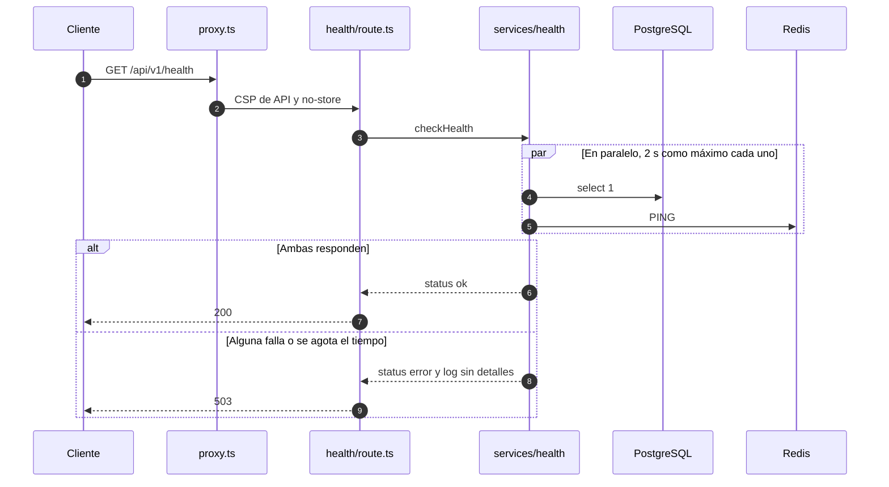

# API

La API vive bajo `/api/v1` en el mismo origen que la interfaz. La implementan Route Handlers de Next.js en [`apps/rutasegura/src/app/api`](../apps/rutasegura/src/app/api), y sus tipos y esquemas están en [`packages/contracts`](../packages/contracts/src).

## Convenciones

| Aspecto    | Regla                                                                                                                                    |
| ---------- | ---------------------------------------------------------------------------------------------------------------------------------------- |
| Versión    | Prefijo `/api/v1`. Un cambio incompatible abre `/api/v2`                                                                                 |
| Formato    | JSON en peticiones y respuestas                                                                                                          |
| Caché      | Toda respuesta de API lleva `Cache-Control: no-store`                                                                                    |
| CSP        | `default-src 'none'; frame-ancestors 'none'; base-uri 'none'; form-action 'none'`: una respuesta JSON nunca se interpreta como documento |
| Errores    | Cuerpo `{ "error": { "code", "message" } }` con un mensaje fijo por código                                                               |
| Identidad  | El servidor deriva el usuario de la sesión. Ningún endpoint acepta `userId`, `ownerId` ni roles en el cuerpo o la URL                    |
| Validación | Esquemas Zod en el servidor, siempre, aunque la UI ya haya validado                                                                      |

Además de lo anterior, cada respuesta lleva las cabeceras de seguridad comunes descritas en [seguridad.md](seguridad.md).

## Endpoints disponibles

### `GET /api/v1/health`

Comprueba PostgreSQL y Redis en paralelo, cada uno con un tiempo límite de 2 segundos. Lo usan el healthcheck de Docker Compose y cualquier monitor externo.

Todo en orden, `200`:

```json
{ "status": "ok", "checks": { "database": "ok", "redis": "ok" } }
```

Alguna dependencia falla o no responde a tiempo, `503`:

```json
{ "status": "error", "checks": { "database": "ok", "redis": "error" } }
```

La respuesta nunca incluye mensajes de error, cadenas de conexión ni versiones. El detalle queda en el log del servidor, reducido al tipo de error:

```json
{ "level": "error", "event": "health.dependency_failed", "dependency": "redis", "kind": "Error" }
```



### Autenticación

Todas las mutaciones exigen `Content-Type: application/json` (cuerpo de 16 KiB como máximo) y, si el navegador envía `Origin`, que sea el de la app; de lo contrario, `403 forbidden`. El diseño completo está en [autenticacion.md](autenticacion.md).

#### `POST /api/v1/auth/register`

```json
{ "email": "ana@example.org", "password": "caballo-bateria-grapa", "fullName": "Ana Pérez" }
```

| Respuesta | Cuándo                                                                           |
| --------- | -------------------------------------------------------------------------------- |
| `201`     | `{"status":"accepted"}`, tanto si la cuenta se creó como si el correo ya existía |
| `400`     | Cuerpo inválido, contraseña fuera de política o campos adicionales               |
| `429`     | Más de 5 registros por IP en una hora                                            |

#### `POST /api/v1/auth/login`

```json
{ "email": "ana@example.org", "password": "caballo-bateria-grapa" }
```

`200` con el usuario y dos cookies `HttpOnly; SameSite=Lax` (JWT de acceso y refresh token):

```json
{ "user": { "id": "…", "email": "ana@example.org", "fullName": "Ana Pérez", "role": "customer" } }
```

| Respuesta | Cuándo                                                                               |
| --------- | ------------------------------------------------------------------------------------ |
| `401`     | `invalid_credentials`: usuario inexistente, contraseña incorrecta o cuenta bloqueada |
| `429`     | Más de 10 intentos por IP o por correo en 15 min, con `Retry-After`                  |
| `503`     | Redis no disponible: el rate limit falla cerrado                                     |

#### `POST /api/v1/auth/refresh`

Sin cuerpo. Usa la cookie de refresh, la rota y emite cookies nuevas. `200` con el usuario, o `401` (y cookies borradas) si el token no existe, venció o ya se había rotado. Reutilizar un token rotado revoca todas las sesiones de ese login.

#### `POST /api/v1/auth/logout`

Sin cuerpo. Revoca la sesión y borra las cookies. Siempre `204`.

#### `GET /api/v1/auth/me`

Ruta protegida. `200 {"user": …}` con un JWT válido y una sesión vigente; `401 unauthorized` en cualquier otro caso (sin cookie, token alterado o vencido, sesión cerrada).

### `POST /api/v1/tracking`

Consulta pública de una guía con doble dato:

```json
{ "trackingNumber": "RS0000000001", "phoneLast4": "4321" }
```

`200`, solo con estado y recorrido:

```json
{
  "trackingNumber": "RS0000000001",
  "status": "out_for_delivery",
  "events": [
    { "status": "created", "city": "Bogotá", "occurredAt": "2026-09-20T13:00:00.000Z" },
    { "status": "in_transit", "city": "Bogotá", "occurredAt": "2026-09-21T09:30:00.000Z" },
    { "status": "out_for_delivery", "city": "Medellín", "occurredAt": "2026-09-22T07:15:00.000Z" }
  ]
}
```

| Respuesta | Cuándo                                                                       |
| --------- | ---------------------------------------------------------------------------- |
| `400`     | Guía fuera del formato `RS` más 10 dígitos, o dígitos que no sean 4          |
| `404`     | `tracking_not_found`: guía inexistente o dígitos incorrectos, sin distinción |
| `429`     | Más de 5 consultas por IP o por guía en 15 min                               |

La semilla de desarrollo crea `RS0000000001` (dígitos `4321`) y `RS0000000002` (dígitos `9876`), con datos ficticios.

### Rutas inexistentes

Cualquier ruta bajo `/api/` sin handler (por ejemplo `/api/v1/no-existe`) responde con el mismo cuerpo, sea cual sea el método (`GET`, `POST`, `PUT`, `PATCH`, `DELETE`):

```json
{ "error": { "code": "not_found", "message": "El recurso solicitado no existe." } }
```

Lo implementa [`api/[...path]/route.ts`](../apps/rutasegura/src/app/api/%5B...path%5D/route.ts). Así la API no devuelve la página HTML de error de Next ni revela qué rutas existen.

## Códigos de error

Definidos en [`packages/contracts/src/errors.ts`](../packages/contracts/src/errors.ts) y emitidos solo mediante `apiError()` de [`server/http/responses.ts`](../apps/rutasegura/src/server/http/responses.ts).

| Código                | HTTP | Mensaje                                                                    |
| --------------------- | ---- | -------------------------------------------------------------------------- |
| `bad_request`         | 400  | La solicitud no es válida.                                                 |
| `unauthorized`        | 401  | No fue posible verificar la solicitud.                                     |
| `invalid_credentials` | 401  | Correo o contraseña incorrectos, o la cuenta está bloqueada temporalmente. |
| `forbidden`           | 403  | No tienes acceso a este recurso.                                           |
| `not_found`           | 404  | El recurso solicitado no existe.                                           |
| `tracking_not_found`  | 404  | No encontramos un envío con ese número de guía y esos datos.               |
| `rate_limited`        | 429  | Demasiados intentos. Vuelve a intentarlo más tarde.                        |
| `internal_error`      | 500  | Ocurrió un error inesperado.                                               |
| `service_unavailable` | 503  | El servicio no está disponible en este momento.                            |

El mensaje depende solo del código, nunca de la causa interna. Esto es deliberado: si la API respondiera distinto a "la guía no existe" y a "el segundo dato no coincide", o a "el usuario no existe" y a "la contraseña es incorrecta", entregaría un oráculo para enumerar guías o cuentas.

## Endpoints reservados

Las carpetas existen, pero todavía no tienen handler: hoy responden con el 404 genérico.

| Ruta                | Propósito                   | Phase | Control principal                                                     |
| ------------------- | --------------------------- | ----- | --------------------------------------------------------------------- |
| `/api/v1/auth/totp` | Segundo factor opcional     | 8     | TOTP con secreto cifrado y códigos de recuperación                    |
| `/api/v1/shipments` | Envíos y agenda del usuario | 9     | `assertOwnership` por objeto, identificadores ULID, RLS en PostgreSQL |
| `/api/v1/documents` | Descarga de soportes        | 10    | Bucket privado y URL firmada de 60 s                                  |

Cuando se implementen, cada una se documenta aquí con su contrato, sus errores y su prueba de autorización negativa.
