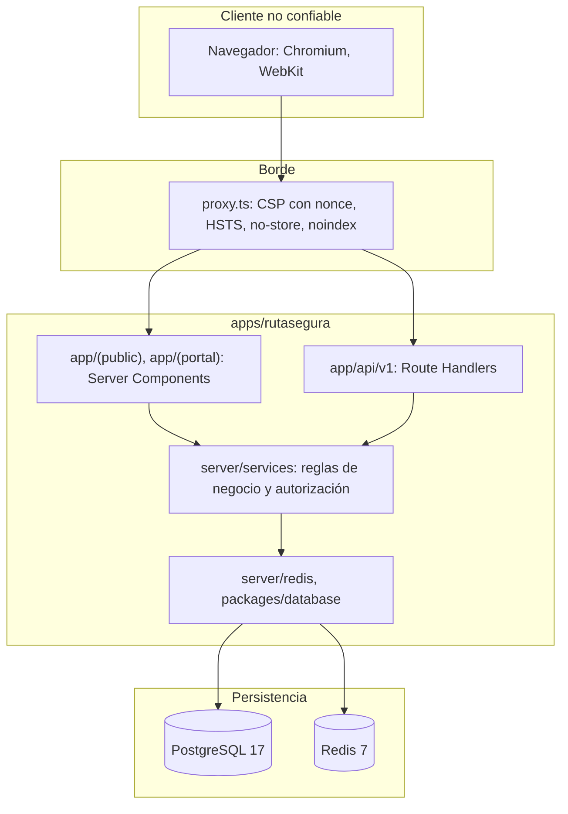

# Arquitectura

RutaSegura es una única aplicación full-stack de Next.js 16 (App Router). La interfaz, la API bajo `/api/v1` y la lógica de servidor viven en `apps/rutasegura`, se construyen en un solo build y se despliegan como un solo servicio. El navegador consume la API en el mismo origen, con rutas relativas.

Compartir proyecto no significa compartir responsabilidades: solo el código de servidor toca la base de datos, Redis, secretos o sesiones.

## Capas y fronteras de confianza

Cada flecha que cruza hacia abajo es una frontera: todo lo que llega del navegador se valida otra vez en el servidor, y ningún camino llega a la persistencia sin pasar por `server/services`.

## Qué vive en cada carpeta

| Carpeta                                                         | Responsabilidad                                          | Estado                                         |
| --------------------------------------------------------------- | -------------------------------------------------------- | ---------------------------------------------- |
| `src/app/(public)`, `src/app/(portal)`                          | Pantallas públicas y del portal autenticado              | Reservadas para los mockups de Figma (phase 6) |
| `src/app/api/v1/health`                                         | Health check contra PostgreSQL y Redis                   | Implementado                                   |
| `src/app/api/[...path]`                                         | 404 JSON genérico para cualquier ruta de API sin handler | Implementado                                   |
| `src/app/api/v1/{auth,tracking,shipments,documents}`            | Endpoints de negocio                                     | Reservados (phases 8 a 10)                     |
| `src/features/*`                                                | UI y lógica de presentación por dominio                  | Reservado                                      |
| `src/server/env.ts`                                             | Validación de variables con Zod                          | Implementado                                   |
| `src/server/startup.ts`, `src/instrumentation.ts`               | Arranque que falla con configuración inválida            | Implementado                                   |
| `src/server/logger.ts`                                          | Logs JSON sin secretos                                   | Implementado                                   |
| `src/server/http/responses.ts`                                  | Respuestas de error uniformes                            | Implementado                                   |
| `src/server/redis.ts`                                           | Cliente Redis                                            | Implementado                                   |
| `src/server/services/health.ts`                                 | Chequeo de dependencias con tiempo límite                | Implementado                                   |
| `src/server/{auth,authorization,repositories,rate-limit,audit}` | Controles de las siguientes phases                       | Reservado                                      |
| `src/lib/security-headers.ts`                                   | Cabeceras y CSP, sin secretos                            | Implementado                                   |
| `src/proxy.ts`                                                  | Aplica la CSP y las cabeceras por petición               | Implementado                                   |

## Límites que el código hace cumplir

1. **`server-only`.** Todo módulo de `src/server` y el paquete `@rutasegura/database` lo importan. Si un Client Component (`"use client"`) los importa, el build falla.
2. **ESLint.** La regla `no-restricted-imports` de [`apps/rutasegura/eslint.config.mjs`](../apps/rutasegura/eslint.config.mjs) impide que `app/(public)`, `app/(portal)`, `components` y `features` importen la base de datos, los repositorios o Redis. La UI llega a los datos solo por `server/services`.
3. **Autorización en el servidor.** Ningún endpoint acepta `userId`, `ownerId`, `actorId` ni roles desde el navegador. El dueño de un recurso se deriva de la sesión y la propiedad se comprueba por objeto (phase 9).
4. **Contratos compartidos, validación repetida.** Los esquemas Zod de `@rutasegura/contracts` los usan la UI y la API, pero la validación del servidor es la única que cuenta como control.

## Render y disponibilidad

Todo documento se renderiza en el servidor en cada petición (`await connection()` en [`layout.tsx`](../apps/rutasegura/src/app/layout.tsx)), porque la CSP usa un nonce distinto por petición. El contenido útil llega en el HTML aunque el JavaScript del cliente falle o esté desactivado. Es la respuesta directa a la pantalla negra observada en el sitio de referencia; ver [compatibilidad-navegadores.md](compatibilidad-navegadores.md).

## Despliegue

- **Local:** Docker Compose levanta la app, PostgreSQL y Redis ([desarrollo.md](desarrollo.md)).
- **Producción:** imagen `standalone` de Next que corre sin root, o un único proyecto de Vercel con Root Directory `apps/rutasegura`. PostgreSQL y Redis son servicios administrados, y las migraciones corren como paso controlado del despliegue, nunca durante una petición.
