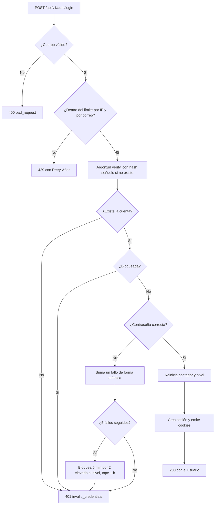
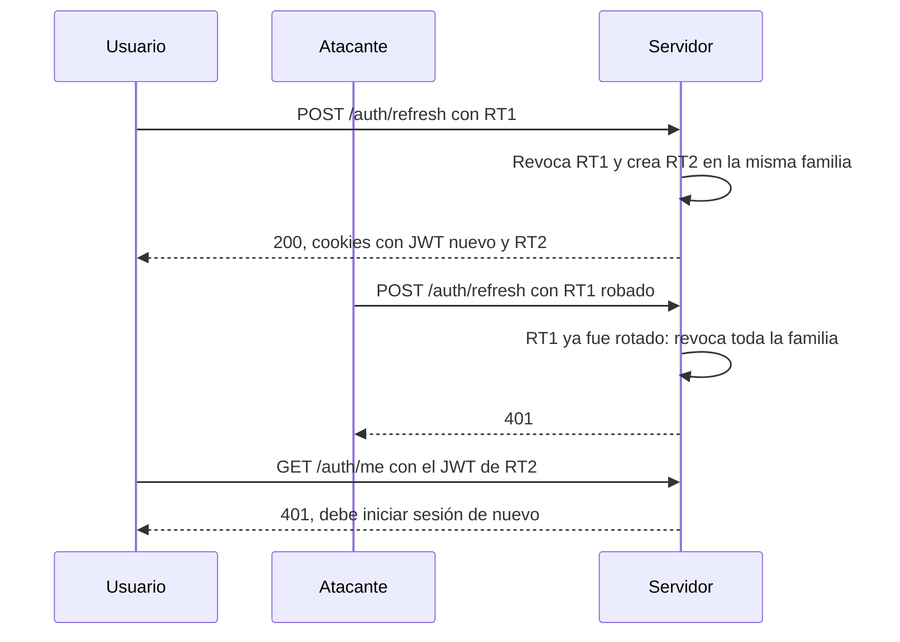
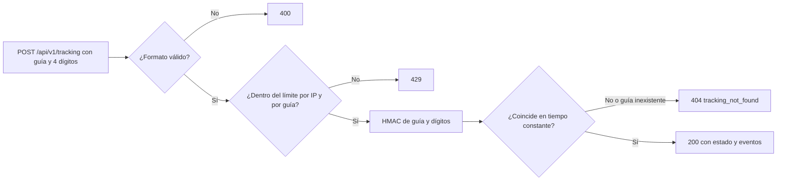

# Autenticación y rastreo

Sprint 1: autenticación en el servidor (Route Handlers de Next.js) y consulta pública de guías con doble dato. Mitiga OWASP A07 (fallas de identificación y autenticación) y A01 (control de acceso roto). El contrato HTTP de cada endpoint está en [api.md](api.md).

## Resumen de controles

| Control                | Implementación                                                                                                       | ¿Dónde vive?                                      |
| ---------------------- | -------------------------------------------------------------------------------------------------------------------- | ------------------------------------------------- |
| Hash de contraseñas    | Argon2id (`@node-rs/argon2`), 19 MiB, 2 iteraciones, paralelismo 1 (mínimo de OWASP), sal aleatoria por hash         | `server/auth/password.ts`                         |
| Política de contraseña | De 12 a 128 caracteres, fuera de una lista de contraseñas comunes y sin contener el correo (NIST SP 800-63B)         | `packages/contracts/src/auth.ts`                  |
| Bloqueo de cuenta      | Tras 5 fallos seguidos, 5 min; cada bloqueo nuevo duplica la duración, con tope de 1 h                               | `server/auth/lockout.ts`, `repositories/users.ts` |
| JWT                    | HS256 con `jose`, 15 min, `iss`, `aud`, `sub`, `sid`, `jti`; algoritmo fijo en la verificación                       | `server/auth/tokens.ts`                           |
| Sesión y refresh       | Refresh token opaco de 256 bits, rotativo; en la base solo su HMAC; reutilización detectada revoca la familia        | `services/auth.ts`, `repositories/sessions.ts`    |
| Cookies                | `HttpOnly; SameSite=Lax; Path=/`; sobre HTTPS además `Secure` y prefijo `__Host-`                                    | `server/auth/cookies.ts`                          |
| CSRF                   | `SameSite=Lax` y rechazo (403) de mutaciones con `Origin` ajeno o `Sec-Fetch-Site: cross-site`                       | `proxy.ts`                                        |
| Rate limiting          | Ventana fija atómica en Redis (script Lua) por IP, por correo y por guía; 429 con `Retry-After`; falla cerrado (503) | `server/rate-limit/`                              |
| Respuestas uniformes   | Usuario inexistente, contraseña incorrecta y cuenta bloqueada responden igual; registro siempre 201 genérico         | `services/auth.ts`, `contracts/errors.ts`         |
| Rastreo de doble dato  | Número de guía más últimos 4 dígitos del teléfono del destinatario, comparados como HMAC en tiempo constante         | `services/tracking.ts`                            |
| Auditoría mínima       | Tabla `auth_events` con 12 tipos de evento; correo, IP y guía solo como HMAC                                         | `server/audit/auth-events.ts`                     |
| Validación y cuerpo    | Zod `.strict()` en cada endpoint; cuerpos JSON de 16 KiB como máximo; ningún campo de rol o dueño llega del cliente  | `server/http/client.ts`, contratos                |

## Registro

`POST /api/v1/auth/register` valida con Zod, calcula el hash Argon2id e inserta el usuario con `ON CONFLICT DO NOTHING`. La respuesta es siempre `201 {"status":"accepted"}`, exista o no el correo, y el hash se calcula en ambos casos para que el tiempo de respuesta tampoco lo delate. El registro no inicia sesión. El rol lo asigna la base (`customer`); el contrato rechaza campos adicionales, así que no se puede enviar `role`.

## Login y bloqueo

- El contador se incrementa con `failed_login_count = failed_login_count + 1` en un solo `UPDATE`, y el bloqueo exige que el contador siga en el umbral. Intentos concurrentes no pueden perder fallos ni aplicar dos bloqueos.
- Durante el bloqueo, incluso la contraseña correcta recibe el mismo 401. La bitácora sí distingue `login_failure`, `login_locked` y `account_locked`.
- El mensaje de 401 menciona ambas posibilidades ("Correo o contraseña incorrectos, o la cuenta está bloqueada temporalmente") para orientar al usuario legítimo sin confirmar nada a un atacante.

## JWT, sesiones y cookies

El login emite dos cookies:

| Cookie                   | Contenido                                   | Vida   |
| ------------------------ | ------------------------------------------- | ------ |
| `rs_at` (`__Host-rs_at`) | JWT de acceso HS256                         | 15 min |
| `rs_rt` (`__Host-rs_rt`) | Refresh token opaco; la base guarda su HMAC | 8 h    |

- Las rutas protegidas llaman a `authenticate()` ([`require-user.ts`](../apps/rutasegura/src/server/auth/require-user.ts)): valida firma, algoritmo (`HS256` fijo, rechaza `alg: none`), emisor, audiencia y vencimiento, y además comprueba que la sesión `sid` siga vigente. Así el logout invalida el JWT al instante, sin esperar a que venza.
- `GET /api/v1/auth/me` es la ruta protegida de referencia; las de envíos (`/api/v1/shipments`, Phase 9) usan el mismo `authenticate()` y además `assertOwnership` por objeto ([seguridad.md](seguridad.md#autorización-por-objeto)).
- Los nombres llevan el prefijo `__Host-` y el atributo `Secure` solo cuando la petición llega por HTTPS: Safari descarta las cookies `Secure` en `http://localhost`. Ver [compatibilidad-navegadores.md](compatibilidad-navegadores.md#cookies-de-sesión-en-webkit).

### Rotación del refresh token

La rotación revoca la fila vieja con `UPDATE ... WHERE revoked_at IS NULL` dentro de una transacción: si dos peticiones presentan el mismo token a la vez, solo una rota.

## Rate limiting

Implementado en [`server/rate-limit`](../apps/rutasegura/src/server/rate-limit) con un script Lua (`INCR` y `PEXPIRE` atómicos) sobre Redis. Las claves son `rl:<alcance>:<dimensión>:<HMAC>`: nunca contienen la IP, el correo ni la guía en claro.

| Endpoint                              | Dimensión | Límite por defecto | Ventana | Variable                                                                  |
| ------------------------------------- | --------- | ------------------ | ------- | ------------------------------------------------------------------------- |
| `POST /api/v1/auth/login`             | IP        | 10                 | 15 min  | `LOGIN_RATE_LIMIT_IP_MAX`, `LOGIN_RATE_LIMIT_WINDOW_SECONDS`              |
| `POST /api/v1/auth/login`             | Correo    | 10                 | 15 min  | `LOGIN_RATE_LIMIT_EMAIL_MAX`                                              |
| `POST /api/v1/auth/register`          | IP        | 5                  | 1 h     | `REGISTER_RATE_LIMIT_MAX`, `REGISTER_RATE_LIMIT_WINDOW_SECONDS`           |
| `POST /api/v1/tracking`               | IP        | 5                  | 15 min  | `TRACKING_RATE_LIMIT_MAX`, `TRACKING_RATE_LIMIT_WINDOW_SECONDS`           |
| `POST /api/v1/tracking`               | Guía      | 5                  | 15 min  | Las mismas                                                                |
| `POST /api/v1/shipments/claim`        | IP y guía | 5                  | 15 min  | Las del rastreo, con los mismos contadores                                |
| `GET` y `PATCH /api/v1/shipments…`    | Usuario   | 60                 | 1 min   | `SHIPMENTS_RATE_LIMIT_MAX`, `SHIPMENTS_RATE_LIMIT_WINDOW_SECONDS`         |
| `GET` y `POST /api/v1/notifications…` | Usuario   | 60                 | 1 min   | `NOTIFICATIONS_RATE_LIMIT_MAX`, `NOTIFICATIONS_RATE_LIMIT_WINDOW_SECONDS` |

- Toda respuesta de estos endpoints lleva `RateLimit-Limit`, `RateLimit-Remaining` y `RateLimit-Reset`. Al excederse: `429 rate_limited` con `Retry-After` en segundos, y un evento `rate_limited` en la bitácora.
- Si Redis no responde, el endpoint devuelve `503`: falla cerrado en lugar de quedar sin límite.
- El límite por correo (10) es mayor que el umbral de bloqueo (5) a propósito: si fueran iguales, el sexto intento siempre recibiría 429 y el bloqueo nunca se observaría.

### Requisito de despliegue: IP del cliente

La IP sale del valor más a la derecha de `X-Forwarded-For`. Next solo completa esa cabecera con la IP del socket cuando el cliente no la envía, así que **sin un proxy delante que la sobrescriba o la extienda, la IP es falsificable**. Vercel, nginx (`$proxy_add_x_forwarded_for`) y Caddy lo hacen. Por eso ningún control crítico depende solo de la IP: el límite por correo, el límite por guía y el bloqueo por cuenta resisten IPs falsificadas, y una prueba smoke lo verifica.

## Rastreo de doble dato

- La consulta va por `POST` para que la guía y los dígitos no queden en URLs, historial ni logs de acceso.
- La base guarda `HMAC-SHA256(HMAC_SECRET, "guía:dígitos")`, no el teléfono. Sin el secreto, una copia de la base no permite probar las 10 000 combinaciones.
- Guía inexistente y dígitos incorrectos dan el mismo 404 y cuestan lo mismo: siempre se calcula y compara un HMAC.
- La respuesta solo trae estado, ciudad y fecha de cada evento. Nunca nombre, teléfono ni dirección del destinatario.
- Con 5 intentos por guía cada 15 min, adivinar los 4 dígitos por fuerza bruta tomaría en promedio 5 000 intentos, unos 10 días por guía.

## Auditoría mínima

La tabla `auth_events` registra cada evento sin datos personales en claro: el correo o la guía (`subject_hash`) y la IP (`ip_hash`) van como HMAC con propósitos distintos, y el user agent se trunca a 200 caracteres.

| Evento                                   | ¿Cuándo?                                                |
| ---------------------------------------- | ------------------------------------------------------- |
| `register_success`, `register_duplicate` | Registro nuevo o con correo existente                   |
| `login_success`, `login_failure`         | Login correcto o credenciales inválidas                 |
| `login_locked`, `account_locked`         | Intento sobre cuenta bloqueada; bloqueo recién aplicado |
| `refresh`, `refresh_reuse`               | Rotación normal; reutilización de un token ya rotado    |
| `logout`                                 | Cierre de sesión                                        |
| `rate_limited`                           | Cualquier 429 de los endpoints de auth o rastreo        |
| `tracking_success`, `tracking_failure`   | Consulta de guía correcta o fallida; reclamo fallido    |

Un fallo al escribir la bitácora se registra en el log, pero no tumba el login del usuario. Los cambios sobre envíos (reclamo, agenda, reprogramación y cambio de estado) van a `shipment_audit_events`, indexada por envío y por actor para consultarla por usuario, con retención de 365 días ([seguridad.md](seguridad.md#autorización-por-objeto)).

## Pruebas

- **Unitarias** (`pnpm test`): hash Argon2id y parámetros; JWT válido, vencido, `alg: none`, otra audiencia, otro emisor, otra clave y rol alterado; duración del bloqueo; limitador; nombres y atributos de cookie; HMAC del rastreo; lectura de IP y límite del cuerpo; rechazo de CSRF en `proxy.ts`; contratos.
- **Smoke en Docker** (`pnpm test:smoke`): 25 casos contra la app real con PostgreSQL y Redis, incluidas las pruebas negativas de IDOR sobre envíos y avisos. Ver [desarrollo.md](desarrollo.md#pruebas-smoke-en-docker).

## Pendiente

- 2FA TOTP opcional.
- Rol de base de datos no dueño en producción para que la RLS se aplique, y purga de la bitácora a los 365 días.
