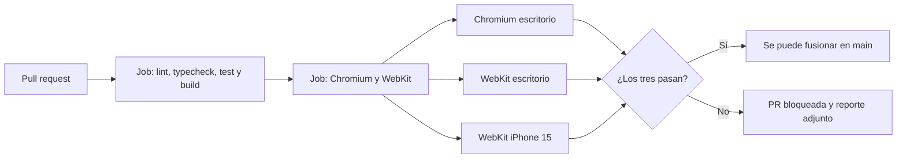

# Compatibilidad con WebKit y Chromium

RutaSegura se ve y funciona igual en navegadores WebKit (Safari en macOS e iOS) y Chromium (Chrome, Edge, Arc, Dia y similares). No es una cuestión estética: es la respuesta al hallazgo más grave del sitio de referencia, y se verifica automáticamente en cada pull request.

## El problema que evitamos

En el [análisis HTTP](https://app.notion.com/p/5d02fd524dd54d9882a908a2ee04bbc6), la vista pública de rastreo del sitio de referencia se quedaba en **pantalla negra en Chromium** (probado en Dia), mientras que en **Safari cargaba completa**. El servidor respondía `200` en ambos casos: el transporte estaba sano, pero el usuario no obtenía servicio.

| Motor            | Navegador | Resultado en el sitio de referencia                          |
| ---------------- | --------- | ------------------------------------------------------------ |
| Chromium (Blink) | Dia       | Pantalla negra, sin mensaje de error ni contenido de reserva |
| WebKit           | Safari    | Carga completa, formulario funcional                         |

Se clasificó como **denegación de servicio en la capa cliente** (STRIDE: Denial of service; OWASP A04 y A05). Las hipótesis compatibles con lo observado eran:

1. Una CSP con `'unsafe-inline'` y `'unsafe-eval'` interpretada de forma distinta por cada motor.
2. Dependencia dura de seis servicios de terceros (Dynatrace, GTM, GA4, reCAPTCHA, Genesys, Yandex) sin manejo de fallos.
3. Una excepción no capturada durante la hidratación que detiene todo el render.
4. Contenido crítico que depende por completo de JavaScript en el cliente, sin HTML de reserva.

## Decisiones que lo evitan

| Decisión                                                                                            | Hipótesis que neutraliza            | ¿Dónde?                         |
| --------------------------------------------------------------------------------------------------- | ----------------------------------- | ------------------------------- |
| Todo documento se renderiza en el servidor; el contenido útil llega en el HTML                      | 3 y 4                               | `layout.tsx`, Server Components |
| Cero scripts, fuentes o estilos de terceros; ningún origen externo en la CSP                        | 2                                   | `security-headers.ts`           |
| CSP estricta y estándar (nonce más `'strict-dynamic'`), igual para ambos motores y probada en ambos | 1                                   | `proxy.ts`                      |
| Fuente del sistema (`system-ui, -apple-system, ...`) en lugar de fuentes descargadas                | 2                                   | `globals.css`                   |
| `100vh` con respaldo `100dvh` y `text-size-adjust` con prefijo `-webkit-`                           | Diferencias de layout en Safari iOS | `globals.css`                   |
| `upgrade-insecure-requests` solo cuando la petición llega por HTTPS                                 | Particularidad de WebKit, ver abajo | `security-headers.ts`           |

### Particularidad de WebKit con `upgrade-insecure-requests`

Chromium exime a `http://localhost` de la directiva `upgrade-insecure-requests`; WebKit no. Si la CSP la incluyera siempre, Safari intentaría cargar por HTTPS los recursos del servidor local, fallaría y la página quedaría sin estilos ni scripts: exactamente el tipo de fallo por motor que queremos evitar. Por eso [`proxy.ts`](../apps/rutasegura/src/proxy.ts) solo la añade, junto con HSTS, cuando la petición ya llega por HTTPS.

### Cookies de sesión en WebKit

La misma diferencia afecta a las cookies. Chromium acepta cookies `Secure` en `http://localhost`; Safari las descarta. Si la sesión usara siempre `Secure` y el prefijo `__Host-`, el login funcionaría en Chrome y fallaría en silencio en Safari durante el desarrollo. Por eso [`cookies.ts`](../apps/rutasegura/src/server/auth/cookies.ts) decide por petición:

| Petición | Nombres                        | Atributos                                |
| -------- | ------------------------------ | ---------------------------------------- |
| HTTPS    | `__Host-rs_at`, `__Host-rs_rt` | `HttpOnly; SameSite=Lax; Path=/; Secure` |
| HTTP     | `rs_at`, `rs_rt`               | `HttpOnly; SameSite=Lax; Path=/`         |

En producción todo llega por HTTPS, así que las cookies siempre llevan `Secure` y `__Host-`.

## ¿Qué se verifica en cada PR?

[`e2e/smoke.spec.ts`](../apps/rutasegura/e2e/smoke.spec.ts) corre con Playwright en tres proyectos definidos en [`playwright.config.ts`](../apps/rutasegura/playwright.config.ts):

| Proyecto        | Motor  | Dispositivo          |
| --------------- | ------ | -------------------- |
| `chromium`      | Blink  | Chrome de escritorio |
| `webkit`        | WebKit | Safari de escritorio |
| `mobile-webkit` | WebKit | iPhone 15            |

En cada uno comprueba que:

- La página responde `200` y el título principal es visible.
- No hay errores en consola ni excepciones de página; una violación de CSP aparece como error y hace fallar la prueba.
- La CSP tiene nonce y no contiene `unsafe-inline` ni `unsafe-eval`.
- Todo `<script>` del documento lleva el nonce de la petición.
- No se envía `X-Powered-By`, y COOP y COEP están activas.
- **Con JavaScript desactivado**, el contenido sigue visible: la página no depende del cliente para pintar.
- Una ruta de API inexistente responde con el 404 JSON genérico y `no-store`.



El job `Chromium y WebKit` es un check obligatorio de la protección de `main`: una PR que rompa la carga en cualquiera de los dos motores no se puede fusionar.

## Evidencia

| Fecha      | ¿Dónde?                                                                        | Resultado                                                                                                     |
| ---------- | ------------------------------------------------------------------------------ | ------------------------------------------------------------------------------------------------------------- |
| 27/09/2026 | Local, macOS                                                                   | 9 de 9 pruebas en Chromium, WebKit y WebKit iPhone                                                            |
| 27/09/2026 | CI de la [PR #1](https://github.com/julianmeoficial/RutaSegura/pull/1), Ubuntu | Job `Chromium y WebKit` en verde                                                                              |
| 27/09/2026 | Imagen de producción en el navegador                                           | 8 scripts, todos con nonce; único origen de recursos el propio; `crossOriginIsolated: true`                   |
| 27/09/2026 | Login desde el navegador contra Docker, WebKit y Chromium                      | Login `200` y `/auth/me` `200` en ambos; cookies `HttpOnly` y `SameSite=Lax`; `document.cookie` no las expone |

Para repetirla localmente:

```bash
pnpm build
pnpm --filter @rutasegura/app exec playwright install chromium webkit
pnpm test:e2e
```

## Regla para la interfaz

Cuando lleguen las pantallas de Figma, cada una debe:

- Pintar su contenido principal desde el servidor, sin depender de JavaScript en el cliente.
- Usar solo recursos propios: nada de CDN, fuentes externas ni scripts de terceros.
- Mostrar un estado de error legible si algo falla, nunca una pantalla vacía.
- Añadir su caso a `e2e/` para que CI la pruebe en ambos motores.
