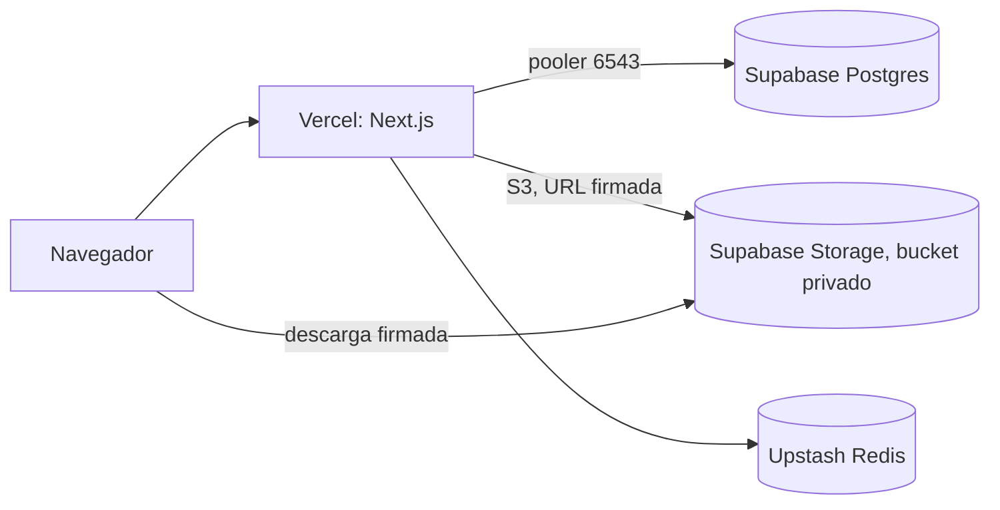

# Despliegue en Vercel con Supabase y Upstash

Cómo se monta el entorno en vivo donde se hace el pentest formal ([pentest-freeze.md](pentest-freeze.md)). La app es la misma imagen que corre en Docker; solo cambian los servicios: PostgreSQL y almacenamiento en Supabase, Redis en Upstash y la app en Vercel.



## Servicios

| Pieza         | Servicio                        | Dato                                                                |
| ------------- | ------------------------------- | ------------------------------------------------------------------- |
| PostgreSQL    | Supabase, proyecto `rutasegura` | Ref `arhieajljrwuwfnifjbf`, región `us-east-1`, plan Free           |
| Archivos (S3) | Supabase Storage                | Bucket privado `rutasegura-private`, solo PDF, máximo 10 MB         |
| Redis         | Upstash, plan Free              | Región `us-east-1`, URL `rediss://`                                 |
| App           | Vercel                          | [https://ruta-segura-one.vercel.app/](https://ruta-segura-one.vercel.app/) · Root Directory `apps/rutasegura`, región `iad1` |

El plan Free de Supabase pausa el proyecto tras 7 días sin actividad. Reactívalo desde el panel antes de cada sesión del pentest.

## Dos conexiones a la base

| Uso                                    | Conexión                               | Puerto |
| -------------------------------------- | -------------------------------------- | ------ |
| Migraciones y semilla, desde tu equipo | Directa o pooler en modo sesión        | 5432   |
| La app en Vercel                       | Pooler en modo transacción (Supavisor) | 6543   |

En el plan Free la conexión directa (`db.<ref>.supabase.co`) solo responde por IPv6. Si tu red no tiene IPv6, migra por el pooler en modo sesión: la misma URL del pooler con el puerto 5432 en lugar del 6543.

Con el puerto 6543 la app desactiva las sentencias preparadas y abre como máximo 3 conexiones por instancia (`connectionOptions` en `packages/database/src/index.ts`). Nunca migres por el 6543.

## Seguridad propia de Supabase

- **RLS:** la migración `0005_enable_rls` activa Row Level Security en las 8 tablas sin crear políticas. La app conecta como dueña de las tablas y no la ve; la API REST de Supabase (roles `anon` y `authenticated`) no puede leer ni escribir nada.
- **Data API:** la app no la usa. Para cerrarla del todo, en **Settings → Data API** quita `public` de los esquemas expuestos.
- **Bucket:** privado, sin políticas de lectura pública. Las descargas solo funcionan con la URL firmada que emite la app (60 s).
- **Llave S3:** tiene acceso total al almacenamiento del proyecto. Solo vive en `.env.supabase` (local, ignorado por Git) y en las variables de Vercel.
- Revisa **Advisors → Security** después de cada migración: no debe quedar ningún aviso crítico.

## Preparar la base y el almacenamiento

Todo sale de `.env.supabase` en la raíz del repositorio (lo ignora el patrón `.env.*`). Las variables que se exportan tienen prioridad sobre el `.env` de desarrollo.

```bash
set -a; source .env.supabase; set +a

DATABASE_URL="$DATABASE_URL_DIRECT" pnpm db:migrate   # 0000 a 0005
DATABASE_URL="$DATABASE_URL_DIRECT" pnpm db:seed      # guías, documentos y cuentas demo
pnpm db:fixtures                                      # sube los 12 PDF a documents/<clave>
```

Los tres comandos se pueden repetir: la semilla no duplica filas y `db:fixtures` no vuelve a subir lo que ya existe.

El `HMAC_SECRET` de la semilla debe ser exactamente el mismo que el de la app en Vercel: los últimos 4 dígitos de cada guía se guardan como HMAC con ese secreto.

## Variables en Vercel

| Variable                                             | Valor                                                            |
| ---------------------------------------------------- | ---------------------------------------------------------------- |
| `APP_ENV`                                            | `production`                                                     |
| `NEXT_PUBLIC_APP_URL`                                | `https://<dominio>`                                              |
| `DATABASE_URL`                                       | Pooler en modo transacción (6543)                                |
| `REDIS_URL`                                          | `rediss://...` de Upstash                                        |
| `SESSION_SECRET`, `CSRF_SECRET`, `HMAC_SECRET`       | Los de `.env.supabase`                                           |
| `STORAGE_ENDPOINT`                                   | `https://arhieajljrwuwfnifjbf.storage.supabase.co/storage/v1/s3` |
| `STORAGE_REGION`, `STORAGE_BUCKET`                   | `us-east-1`, `rutasegura-private`                                |
| `STORAGE_ACCESS_KEY_ID`, `STORAGE_SECRET_ACCESS_KEY` | La llave S3 de Supabase                                          |

Con `APP_ENV=production` la app no arranca si falta alguna, si queda un valor de ejemplo o si una URL no usa https; el log nombra la variable sin mostrar su valor. Los límites y TTL tienen valores por defecto ([.env.example](../.env.example)).

Para el pentest, desactiva **Deployment Protection** en el dominio de producción; los despliegues de preview pueden quedar protegidos.

## Verificación

1. `GET /api/v1/health` responde 200.
2. Rastrear RS0000000009 con `7070` muestra "En reparto".
3. Registrar una cuenta en `/registro` crea la fila en `users` (Supabase → Table Editor), con la contraseña en Argon2id.
4. Entrar como `luis.demo@rutasegura.test` ([datos-de-prueba.md](datos-de-prueba.md)) y descargar un documento.
5. Seis rastreos fallidos seguidos responden 429 con `Retry-After`: Redis funciona.

Antes de desplegar se puede hacer la misma prueba en local contra los servicios reales:

```bash
pnpm build
set -a; source .env.supabase; set +a
APP_ENV=preview NEXT_PUBLIC_APP_URL=http://127.0.0.1:3200 \
  pnpm --filter @rutasegura/app exec next start --port 3200
```

Sobre http las cookies no llevan `Secure` ni el prefijo `__Host-`, así que el login funciona en local.
