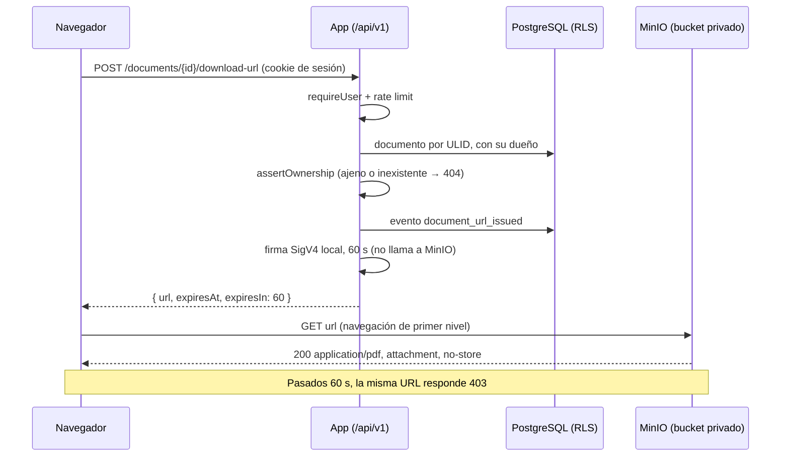

# Documentos con URL firmada

Los soportes de un envío (guía de transporte, factura, prueba de entrega) viven en un **bucket privado**. No tienen dirección pública ni permanente: la única forma de descargarlos es una URL firmada que la app emite al pulsar "Descargar", solo para el dueño del envío y válida por **60 segundos**. Cubre OWASP A01 (acceso a objetos ajenos) y A05 (bucket público por mala configuración).

## Garantías

| Garantía                                | ¿Cómo se cumple?                                                                                            | ¿Cómo se verifica?                                      |
| --------------------------------------- | ----------------------------------------------------------------------------------------------------------- | ------------------------------------------------------- |
| El bucket no es público                 | Sin política anónima (`mc anonymous set none`): todo GET o listado sin firma responde 403                   | `evidence-signed-urls.sh`, `documents.smoke.test.ts`    |
| Ninguna URL permanente                  | La API nunca devuelve la clave del objeto ni el endpoint del almacenamiento; solo URLs firmadas que vencen  | `documents.smoke.test.ts` (listado sin `objectKey`)     |
| La URL vence a los 60 s                 | Firma SigV4 con `X-Amz-Expires=60`; vencida, MinIO responde `403 AccessDenied: Request has expired`         | Smoke y evidencia esperan el vencimiento real           |
| No se puede alargar ni falsificar       | `X-Amz-Expires` y los parámetros `response-*` están dentro de la firma; cambiar un carácter da 403          | Smoke y evidencia                                       |
| Solo el dueño obtiene la URL            | `assertOwnership` antes de firmar; documento ajeno, inexistente o mal formado: el mismo `404 not_found`     | `documents.test.ts`, smoke (Dave contra Carol), RLS     |
| La app no puede escribir ni borrar      | Política `rutasegura-documents`: solo `GetObject`/`ListBucket` bajo `documents/*`; la root solo la usan los contenedores | Evidencia: escritura con la cuenta de la app → denegado; `mc admin policy info` sin `*` |
| Cada emisión queda registrada           | Evento `document_url_issued` en `shipment_audit_events`, con actor; la URL nunca va a logs ni a la bitácora | Smoke y E2E (bitácora del envío)                        |
| La descarga no queda en cachés          | `Cache-Control: no-store` en la respuesta de la API y como `response-cache-control` firmado en el objeto    | Smoke y evidencia                                       |
| El archivo se descarga, no se renderiza | `response-content-disposition: attachment` firmado: el PDF no se abre como página del origen del bucket     | Smoke, evidencia y E2E (evento `download`)              |
| Abuso de emisión limitado               | 30 URLs por usuario por minuto (`DOCUMENTS_RATE_LIMIT_*`), con 429 y `Retry-After`                          | Smoke                                                   |

## Flujo



La firma se calcula en el servidor con las credenciales de solo lectura; no hay petición a MinIO para emitirla. El navegador descarga con una navegación de primer nivel, no con `fetch`, así que la CSP (`connect-src 'self'`) no cambia y el bucket no necesita CORS.

## Modelo de datos

Tabla `documents` (migración `0004_documents.sql`):

| Columna       | Tipo y restricciones                                                |
| ------------- | ------------------------------------------------------------------- |
| `public_id`   | ULID único: el único identificador que sale del servidor            |
| `shipment_id` | FK a `shipments`, con borrado en cascada                            |
| `object_key`  | Clave opaca y única en el bucket (`documents/<aleatorio>`); no sale |
| `file_name`   | Nombre para la descarga, de 1 a 160 caracteres                      |
| `mime_type`   | `application/pdf`, `image/jpeg` o `image/png`                       |
| `size_bytes`  | De 1 B a 10 MiB                                                     |
| `sha256`      | Hash hexadecimal del contenido, para verificar integridad           |

RLS: `documents_select` hereda la visibilidad del envío (dueño de la sesión o modo operador); la inserción solo en modo operador. En este sprint los documentos los carga la semilla: no hay subida desde la interfaz.

## Configuración

| Variable                                     | Uso                                                                               |
| -------------------------------------------- | --------------------------------------------------------------------------------- |
| `STORAGE_ENDPOINT`                           | Endpoint que usa el servidor (en Compose, `http://minio:9000`)                    |
| `STORAGE_PUBLIC_ENDPOINT`                    | Endpoint contra el que se firma: el que alcanza el navegador. HTTPS en producción |
| `STORAGE_REGION`, `STORAGE_BUCKET`           | Región de la firma y bucket privado                                               |
| `STORAGE_ACCESS_KEY_ID`, `..._SECRET_...`    | Cuenta de **solo lectura** de la app                                              |
| `SIGNED_URL_TTL_SECONDS`                     | Vigencia de la URL: 60 por defecto, 300 como máximo (lo valida `env.ts`)          |
| `DOCUMENTS_RATE_LIMIT_MAX`, `..._WINDOW_...` | Emisiones por usuario y ventana (30 por 60 s)                                     |
| `MINIO_ROOT_USER`, `MINIO_ROOT_PASSWORD`     | Solo para los contenedores `minio` y `minio-init`; la app nunca los recibe        |

Con `APP_ENV=production`, la app no arranca si falta alguna variable de almacenamiento, si conserva un valor de ejemplo o si `STORAGE_PUBLIC_ENDPOINT` no es HTTPS. Fuera de producción el almacenamiento es opcional: sin él, la descarga responde `503 service_unavailable` y el resto de la app funciona.

En local, `minio-init` crea el bucket, quita cualquier acceso anónimo, crea la cuenta de la app con la política `rutasegura-documents` (solo el prefijo `documents/*`) y sube los PDF ficticios de [`packages/database/fixtures/documents`](../packages/database/fixtures/documents). MinIO ya no publica imágenes en Docker Hub, así que Compose usa la imagen de Chainguard fijada por digest. La consola web de MinIO está apagada y el puerto 9000 se publica solo en `127.0.0.1`.

**En producción** (S3, R2 o equivalente): bloqueo de acceso público activo a nivel de cuenta y de bucket, sin políticas anónimas ni ACL públicas, credenciales de la app limitadas a `GetObject` sobre el bucket y endpoint HTTPS.

## Interfaz

En `/portal/documentos` y en el detalle de cada envío:

1. "Descargar" pide la URL en ese momento; nunca se pinta una URL en el HTML.
2. La descarga empieza sola y la tarjeta muestra "Enlace vigente · 00:59" con cuenta regresiva.
3. Al llegar a cero, la tarjeta pasa a "Enlace expirado" y ofrece "Generar enlace", que emite una URL nueva (y un nuevo evento de bitácora).
4. 404, 429 (con la espera de `Retry-After`), 503 y la sesión vencida tienen mensajes propios; la sesión vencida lleva al login y vuelve a la misma página.

## Evidencia de que el bucket no es público

Se reproduce con el entorno Docker levantado:

```bash
./scripts/evidence-signed-urls.sh
```

El script sale con error si alguna comprobación falla, y CI lo corre en cada PR (job "Smoke y flujos de UI en Docker"). Salida capturada el 2026-10-13 sobre la rama `frontend_imp` (firma oculta):

```text
== 1. Configuración del bucket en MinIO
Access permission for `local/rutasegura-private` is `private`
Política anónima (JSON): {}
  OK    La cuenta de la app no puede escribir en el bucket         denegado

== 2. Acceso anónimo directo al almacenamiento (http://localhost:9000)
  OK    GET objeto sin firma (/rutasegura-private/documents/…)   403
  OK    Listado del bucket sin firma (/rutasegura-private)         403
  OK    Listado ListObjectsV2 sin firma (?list-type=2)             403
  OK    Listado de buckets sin firma (/)                           403

== 3. URL firmada emitida por la app
  URL firmada (firma oculta): http://localhost:9000/rutasegura-private/documents/f6d3s8a1g5h9j2k4?X-Amz-Algorithm=AWS4-HMAC-SHA256&X-Amz-Content-Sha256=UNSIGNED-PAYLOAD&X-Amz-Credential=rutasegura-app%2F20261013%2Fus-east-1%2Fs3%2Faws4_request&X-Amz-Date=20261013T222046Z&X-Amz-Expires=60&X-Amz-Signature=%E2%80%A6&X-Amz-SignedHeaders=host&response-cache-control=no-store&response-content-disposition=attachment%3B+filename%3D%22Soporte+de+entrega.pdf%22%3B+filename*%3DUTF-8%27%27Soporte%2520de%2520entrega.pdf&response-content-type=application%2Fpdf&x-id=GetObject
  OK    TTL informado por la API (expiresIn)                       60
  OK    X-Amz-Expires de la firma                                  60
  OK    GET con la firma vigente                                   200
  OK    Content-Disposition                                        attachment
  OK    Cache-Control                                              no-store
  OK    GET de la misma ruta sin la firma                          403
  OK    GET con la firma alterada (un carácter)                   403
  OK    GET con el plazo ampliado a 7 días                        403
  Esperando 62 s a que venza la firma…
  OK    GET con la firma vencida                                   403
  OK    Código de error de MinIO al vencer                        AccessDenied
  Mensaje de MinIO: Request has expired

== 4. Bitácora: cada URL emitida queda registrada
        type         | count
---------------------+-------
 document_url_issued |     3
(1 row)

Todas las comprobaciones pasaron.
```

## Pruebas

| Prueba                                                                          | ¿Qué cubre?                                                                                     |
| ------------------------------------------------------------------------------- | ----------------------------------------------------------------------------------------------- |
| [`signer.test.ts`](../apps/rutasegura/src/server/storage/signer.test.ts)        | TTL en la firma, parámetros `response-*`, el secreto nunca en la URL, `Content-Disposition`     |
| [`documents.test.ts`](../apps/rutasegura/src/server/services/documents.test.ts) | Dueño, ajeno, inexistente, documento sin dueño, almacenamiento caído, auditoría antes de firmar |
| [`documents.smoke.test.ts`](../apps/rutasegura/smoke/documents.smoke.test.ts)   | API real con MinIO: IDOR, 403 sin firma, firma alterada, vencimiento real, bitácora, 429        |
| [`portal.flow.spec.ts`](../apps/rutasegura/e2e-flows/portal.flow.spec.ts)       | Chromium y WebKit: descarga desde la UI, cuenta regresiva y "Generar enlace" al vencer          |

## Límites conocidos

- **Mientras está vigente, la URL es un bearer token.** Quien la tenga puede descargar durante esos 60 s; no se puede revocar antes. Lo acotan el TTL corto, `no-store`, `Referrer-Policy: strict-origin-when-cross-origin` (la URL no viaja como referer) y la bitácora de emisiones.
- **La URL firmada revela el nombre del bucket, la clave opaca del objeto y el id de la cuenta de lectura**, nunca el secreto. Sin firma válida, ninguno de esos datos sirve para leer.
- Los relojes de la app y del almacenamiento deben estar sincronizados (NTP): la vigencia se calcula con la hora de la firma.
