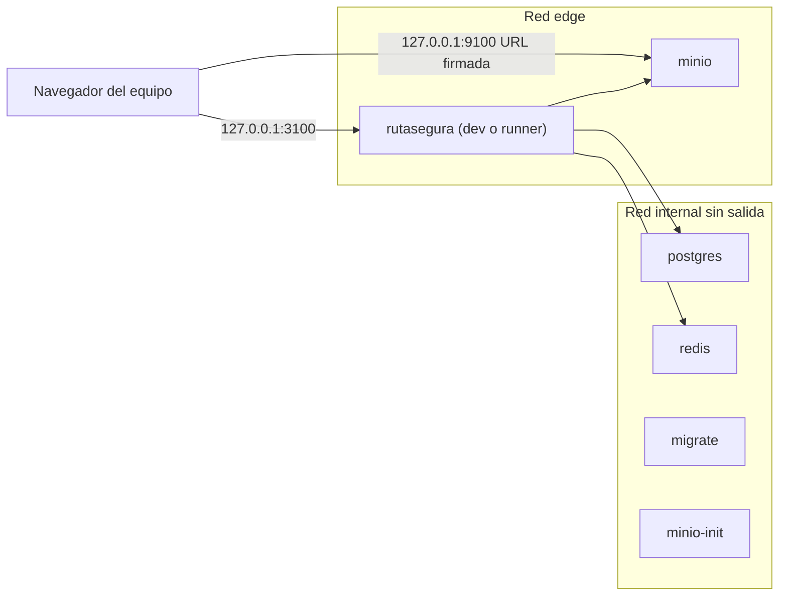

# Entorno aislado para pentest

Stack Docker propio de RutaSegura para ensayar el pentest y revisar la UI en esta máquina, con datos ficticios y un snapshot restaurable. El pentest formal se hace sobre el despliegue de Vercel ([pentest-freeze.md](pentest-freeze.md)); este entorno sirve para preparar las pruebas, ver cómo se comportan las pantallas y volver al estado inicial después de cada ensayo.

| Dato     | Valor                                                                                      |
| -------- | ------------------------------------------------------------------------------------------ |
| Comando  | `pnpm pentest:up` (producción) o `pnpm pentest:dev` (dev server con recarga)               |
| App      | `http://127.0.0.1:3100`                                                                    |
| MinIO    | `http://127.0.0.1:9100`, solo para las URL firmadas de descarga                            |
| Proyecto | Compose `rutasegura-pentest`, con contenedores, volúmenes y `.env.pentest` propios         |
| Snapshot | `pre-pentest` en `.pentest-snapshots/`, se toma solo en el primer `up`                     |
| Datos    | Solo ficticios; `verify-data` lo comprueba en cada `up` y en cada restauración             |
| Acceso   | Solo desde esta máquina (`127.0.0.1`); PostgreSQL y Redis sin puertos ni salida a internet |

## Arquitectura



- `compose.pentest.yaml` se aplica sobre `compose.yaml`: cambia el archivo de entorno por `.env.pentest`, publica la app y MinIO solo en `127.0.0.1`, quita los puertos de PostgreSQL y Redis y separa las redes.
- La red `internal` está marcada `internal: true`: PostgreSQL, Redis, `migrate` y `minio-init` no tienen salida a internet. La app y MinIO están además en `edge` para poder publicar su puerto.
- `compose.pentest.dev.yaml` se añade solo en modo dev: monta `apps/rutasegura/src`, `public` y `packages/contracts/src` en solo lectura y activa `WATCHPACK_POLLING` para que la recarga funcione en Docker Desktop de macOS.
- El entorno convive con el stack de desarrollo (`docker compose up`, app en `localhost:3000`): proyectos, volúmenes y puertos distintos.

**¿Por qué** `127.0.0.1` **y no** `localhost`**?** Los navegadores no separan las cookies por puerto. Con orígenes distintos (`127.0.0.1:3100` frente a `localhost:3000`), las cookies `rs_at` y `rs_rt` de un stack no pisan las del otro. Abre siempre el entorno por `http://127.0.0.1:3100`; la protección de origen de `proxy.ts` rechaza las mutaciones que lleguen desde `localhost:3100`.

## Comandos

```bash
pnpm pentest:up         # Modo runner: imagen de producción, CSP estricta
pnpm pentest:dev        # Modo dev: next dev con recarga al editar src
pnpm pentest:status     # Salud, puertos y aislamiento de red
pnpm pentest:snapshot   # Snapshot con nombre: pnpm pentest:snapshot antes-idor
pnpm pentest:restore    # Restaura pre-pentest (o el nombre que se pase)
pnpm pentest:down       # Detiene el entorno y conserva los datos
```

El script completo es `./scripts/pentest-env.sh`; sin argumentos muestra la ayuda.

| Subcomando             | ¿Qué hace?                                                                                                                     |
| ---------------------- | ------------------------------------------------------------------------------------------------------------------------------ |
| `up [--dev\|--runner]` | Crea `.env.pentest` si falta, levanta con `--wait`, siembra las cuentas, corre `verify-data` y toma `pre-pentest` si no existe |
| `snapshot [nombre]`    | Detiene el entorno, empaqueta los volúmenes, escribe el manifest y vuelve a levantar                                           |
| `restore [nombre]`     | Verifica los SHA-256, reemplaza los volúmenes, levanta y corre `verify-data` (por defecto `pre-pentest`)                       |
| `list`                 | Snapshots disponibles con fecha y commit                                                                                       |
| `status`               | Health, puertos publicados y prueba de salida a internet desde PostgreSQL y Redis                                              |
| `verify-data`          | Confirmación ética automatizada, ver [Datos de prueba](#datos-de-prueba)                                                       |
| `seed-accounts`        | Registra las cuentas de prueba por la API y les vincula una guía; limpia los contadores de rate limit                          |
| `logs [servicio]`      | Logs del entorno                                                                                                               |
| `down`                 | Detiene y borra los contenedores; conserva volúmenes y snapshots                                                               |
| `destroy [--yes]`      | Borra contenedores y volúmenes, con confirmación; los snapshots se conservan                                                   |

## Modos

| Modo   | Comando            | Imagen                            | ¿Para qué?                                                                                  |
| ------ | ------------------ | --------------------------------- | ------------------------------------------------------------------------------------------- |
| runner | `pnpm pentest:up`  | Target `runner` (standalone)      | Ensayar el pentest: CSP sin `unsafe-*`, HSTS y el mismo build que se despliega en Vercel    |
| dev    | `pnpm pentest:dev` | Target `development` (`next dev`) | Mirar la UI y sus comportamientos mientras se edita: un cambio en `src` aparece en segundos |

El modo queda guardado en `APP_BUILD_TARGET` de `.env.pentest`; los demás subcomandos usan el último. En modo dev la CSP añade `'unsafe-eval'`, que necesita `next dev`: no reportes eso como hallazgo, ensaya siempre en runner.

Cambiar de modo no toca los datos: los volúmenes son los mismos.

## Primer arranque

```bash
pnpm pentest:up
```

1. Genera `.env.pentest` a partir de `.env.example` con `APP_ENV=preview`, los puertos 3100 y 9100 y secretos propios (`openssl rand`) para PostgreSQL, sesiones, CSRF, HMAC, MinIO y las cuentas de prueba. El archivo queda con permisos `600` y está ignorado por git.
2. Construye la imagen, aplica las migraciones, carga la semilla y sube los PDF al bucket privado.
3. Registra `alice`, `bob` y `carol` y les vincula una guía a cada una.
4. Corre `verify-data`.
5. Toma el snapshot `pre-pentest`.

No borres `.env.pentest` mientras existan snapshots: la contraseña de PostgreSQL y el `HMAC_SECRET` con el que la semilla calculó los hashes de rastreo están dentro de los volúmenes. Con un `.env.pentest` nuevo, la restauración falla al conectar a la base y el rastreo deja de encontrar las guías. Si hay que empezar de cero, borra los tres: `./scripts/pentest-env.sh destroy`, `.env.pentest` y `.pentest-snapshots/`.

## Snapshot y restauración

Un snapshot es una copia de los tres volúmenes del proyecto (`postgres_data`, `redis_data` y `minio_data`) tomada con el entorno detenido, para que sea consistente.

```text
.pentest-snapshots/pre-pentest/
├── manifest.txt
├── postgres_data.tar.gz
├── redis_data.tar.gz
└── minio_data.tar.gz
```

```text
snapshot: pre-pentest
fecha: 2026-10-15T00:41:08Z
commit: bf4167fe75f6981479b4bb860adb179214d80dd4 (con cambios sin commit)
modo: runner
imagen_app: sha256:…
sha256 postgres_data.tar.gz …
sha256 redis_data.tar.gz …
sha256 minio_data.tar.gz …
```

**Restaurar después de un ensayo**

```bash
pnpm pentest:restore                              # pre-pentest
./scripts/pentest-env.sh restore antes-idor       # otro snapshot
```

1. Comprueba el SHA-256 de cada tar contra el manifest. Si uno no coincide, se detiene sin tocar los volúmenes.
2. Crea los volúmenes si el entorno se destruyó y detiene los contenedores.
3. Vacía cada volumen y extrae su tar.
4. Levanta el entorno, espera el health y corre `verify-data`.

Lo que se haya hecho durante el ensayo (cuentas nuevas, guías vinculadas, franjas, eventos de auditoría, bloqueos y contadores de Redis) desaparece. Comprobado: con una cuenta extra y RS0000000002 vinculada, la restauración dejó 3 usuarios, RS0000000002 libre y la bitácora como estaba.

**Snapshots intermedios.** Antes de una prueba destructiva, guarda el estado con un nombre (`pnpm pentest:snapshot antes-idor`) para volver a ese punto sin repetir la preparación. Los snapshots pesan unos 7 MB, están en `.gitignore` y `.dockerignore` y no se comparten: cada miembro genera los suyos.

## Datos de prueba

Todo es ficticio. Las guías, sus dígitos, las cuentas demo y las de este entorno están en [datos-de-prueba.md](datos-de-prueba.md). Además de las 12 guías y las dos cuentas demo de la semilla, el script registra `alice`, `bob` y `carol` `@pentest.example` con una guía distinta cada una; su contraseña está en `PENTEST_ACCOUNT_PASSWORD` de `.env.pentest`. Con dos cuentas que tienen guías distintas, las pruebas de IDOR (por ejemplo, pedir con la sesión de bob el envío o los documentos de alice) están listas sin preparar nada.

`verify-data` **falla si algo de esto no se cumple:**

| Comprobación | Regla                                                                                                                          |
| ------------ | ------------------------------------------------------------------------------------------------------------------------------ |
| Entorno      | `APP_ENV` no es `production`                                                                                                   |
| Servicios    | `DATABASE_URL`, `REDIS_URL` y `STORAGE_ENDPOINT` de la app apuntan a `postgres`, `redis` y `minio` del proyecto                |
| URL pública  | `NEXT_PUBLIC_APP_URL` está en `127.0.0.1`                                                                                      |
| Guías        | Las 20 siguen el patrón `RS00000000NN` con destinatario `Destinatario de prueba N`                                             |
| Usuarios     | Todos los correos son de dominios reservados: `pentest.example`, `rutasegura.test`, `example.org`, `flows.test` o `smoke.test` |
| Documentos   | El bucket tiene un objeto por documento, y el SHA-256 del fixture del repositorio y el del objeto coinciden con el de la base  |

Al registrar cuentas durante el ensayo, usa esos dominios (por ejemplo `tester1@pentest.example`); una cuenta con otro dominio hace fallar `verify-data` hasta que restaures.

## Controles de acceso

| Control                          | ¿Cómo está hecho?                                     | ¿Cómo verificarlo?                                                                              |
| -------------------------------- | ----------------------------------------------------- | ----------------------------------------------------------------------------------------------- |
| App y MinIO solo en esta máquina | Puertos publicados en `127.0.0.1`, no en `0.0.0.0`    | `pnpm pentest:status`; desde otro equipo de la red, `http://<IP de la máquina>:3100` no conecta |
| PostgreSQL y Redis sin puerto    | `ports: !reset []`                                    | `pnpm pentest:status`                                                                           |
| PostgreSQL y Redis sin internet  | Red `internal: true`                                  | `pnpm pentest:status` intenta `wget http://example.com` desde ambos                             |
| Consola de MinIO apagada         | `MINIO_BROWSER=off` en `compose.yaml`                 | `http://127.0.0.1:9100` responde solo a URL firmadas                                            |
| Secretos propios                 | Generados en `.env.pentest` (`600`, ignorado por git) | `ls -l .env.pentest`                                                                            |
| Sin indexación                   | `APP_ENV=preview`: `X-Robots-Tag: noindex`            | `curl -sI http://127.0.0.1:3100/`                                                               |

`pnpm pentest:status` termina con error si una de las comprobaciones falla. Salida esperada:

```text
Aislamiento:
  OK     Health http://127.0.0.1:3100/api/v1/health
  OK     Ningún puerto publicado fuera de 127.0.0.1
  OK     App solo en 127.0.0.1:3100
  OK     MinIO solo en 127.0.0.1:9100
  OK     PostgreSQL sin puerto publicado
  OK     Redis sin puerto publicado
  OK     postgres sin salida a internet
  OK     redis sin salida a internet
```

El acceso al entorno queda restringido a quien use esta máquina. Para que otro miembro del equipo ensaye, levanta su propio entorno en su equipo con el mismo comando; no se publica en la red local ni se expone con túneles.

## Declaración ética

El equipo de RutaSegura declara, para el ensayo en este entorno:

1. El entorno contiene solo datos ficticios generados por la semilla del repositorio y por `scripts/pentest-env.sh`. No contiene datos personales reales ni copias de datos de producción.
2. El entorno no se conecta a la base de datos, al almacenamiento ni a ningún servicio de producción: todos los servicios son contenedores del proyecto `rutasegura-pentest`, y PostgreSQL y Redis no tienen salida a internet.
3. Las pruebas se hacen solo contra `127.0.0.1:3100` y `127.0.0.1:9100`. Ninguna herramienta se apunta a sistemas de terceros.
4. Al terminar cada sesión de ensayo, el entorno se restaura a `pre-pentest` o se destruye.
5. Los hallazgos se registran y se comunican solo al equipo, según [pentest-freeze.md](pentest-freeze.md).

**Checklist antes de cada sesión**

| #   | Punto                                                                    | Estado |
| --- | ------------------------------------------------------------------------ | ------ |
| 1   | `pnpm pentest:status` en OK                                              |        |
| 2   | `./scripts/pentest-env.sh verify-data` en OK: solo datos ficticios       |        |
| 3   | Snapshot `pre-pentest` presente (`./scripts/pentest-env.sh list`)        |        |
| 4   | Las herramientas apuntan solo a `127.0.0.1:3100` y `127.0.0.1:9100`      |        |
| 5   | Al terminar: `pnpm pentest:restore` o `./scripts/pentest-env.sh destroy` |        |

**Firmas del equipo**

| Nombre          | Rol                         | Fecha              | Firma     |
| --------------- | --------------------------- | ------------------ | --------- |
| Karina Redondo  | Scrum Master                | Octubre 20 de 2026 | Karina_SM |
| Alexa Ricardo   | Product Owner               | Octubre 20 de 2026 | Alexa_PO  |
| Julián Espitia  | Backend y seguridad         | Octubre 20 de 2026 | JME_DEV   |
| Mónica Vellojín | Diseño, interfaz y frontend | Octubre 20 de 2026 | Moni_DEV  |
