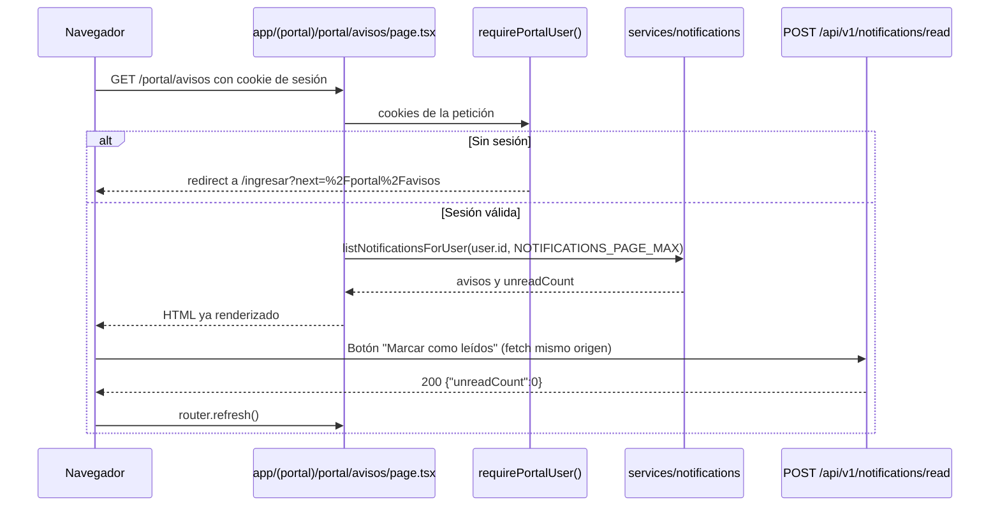

# Notificaciones simuladas

Los avisos que genera la agenda de entregas y los cambios de estado de un envío. La API y la pantalla del portal (`/portal/avisos`) ya están hechas. Esta guía explica qué existe y qué reglas debe respetar cualquier cambio en la UI para no romper los controles de seguridad.

El contrato HTTP de cada endpoint está en [api.md](api.md#notificaciones).

## ¿Qué existe hoy?

| Pieza         | Qué hace                                                                                                                                                         | ¿Dónde vive?                                  |
| ------------- | ---------------------------------------------------------------------------------------------------------------------------------------------------------------- | --------------------------------------------- |
| Generación    | `enqueueNotification` guarda la fila con el cuerpo fijo y registra `notification.enqueued` en el log                                                             | `server/notifications/simulate.ts`            |
| Disparadores  | Agendar (`shipment_scheduled`), reprogramar (`shipment_rescheduled`), cancelar la agenda (`shipment_unscheduled`) y cambio de estado (`shipment_status_changed`) | `server/services/shipments.ts`                |
| Tabla         | `notifications`: `user_id`, `kind`, `body`, `read_at`, `created_at`, con RLS por `app.user_id`                                                                   | migraciones `0001`, `0002` y `0003`           |
| Lectura       | `listNotificationsForUser(userId, limit)` y `GET /api/v1/notifications`                                                                                          | `server/services/notifications.ts`, `app/api` |
| Marcar leídos | `markNotificationsReadForUser(userId)` y `POST /api/v1/notifications/read`                                                                                       | los mismos                                    |
| Contratos     | `notificationSchema`, `notificationListResponseSchema`, `notificationListQuerySchema`                                                                            | `packages/contracts/src/notifications.ts`     |

No hay envío real por correo, SMS ni push: "simulada" significa que el aviso queda en la base y en el log. Si más adelante se conecta un proveedor, se llama desde `enqueueNotification` con el mismo cuerpo fijo.

## Reglas que la UI debe respetar

- **El cuerpo es fijo y no se enriquece.** Siempre es _"Hay una novedad en uno de tus envíos. Entra a RutaSegura para ver el detalle."_. La UI no debe añadir guía, ULID, nombre, teléfono, dirección, ciudad ni franja al aviso, ni en el texto ni en atributos `title` o `aria-label`. El detalle se ve entrando al envío, que sí pasa por `assertOwnership`.
- **El texto por tipo lo pone la UI.** `kind` sirve para elegir icono y título ("Entrega agendada", "Entrega reprogramada", "Agenda cancelada", "Tu envío cambió de estado"). Esos textos viven en el frontend y tampoco llevan datos del envío.
- **Un aviso no enlaza a un envío concreto.** A propósito no trae identificador del envío: el enlace va a la lista de envíos (`/portal`).
- **Nunca se pide por usuario.** La API no acepta `userId` ni `ownerId`; el usuario sale de la sesión. Un parámetro extra en la URL da `400`.

## Cómo está conectado en el portal

La arquitectura obliga a que `app/(portal)`, `components` y `features` lean datos solo mediante `server/services` (regla `no-restricted-imports` en [`eslint.config.mjs`](../apps/rutasegura/eslint.config.mjs)) y a que el contenido útil llegue renderizado en el servidor ([arquitectura.md](arquitectura.md)). La pantalla quedó así:

| Pieza                | Qué hace                                                                                                                          | ¿Dónde vive?                           |
| -------------------- | --------------------------------------------------------------------------------------------------------------------------------- | -------------------------------------- |
| Página "Avisos"      | Lista semántica `aria-label="Tus avisos"`, icono y título por `kind`, marca "Nuevo" en los no leídos y estado vacío               | `app/(portal)/portal/avisos/page.tsx`  |
| Títulos por tipo     | `NOTIFICATION_LABEL`, sin datos del envío                                                                                         | `lib/format.ts`                        |
| Marcar como leídos   | `POST /api/v1/notifications/read` y `router.refresh()`; solo aparece si hay no leídos                                             | `features/portal/mark-read-button.tsx` |
| Contador en cabecera | `listNotificationsForUser(user.id, 1)` en el servidor; la campana lleva `aria-label` "Avisos, N sin leer" y muestra "9+" desde 10 | `components/site-header.tsx`           |
| Pestaña "Avisos"     | Acceso desde la navegación del portal                                                                                             | `features/portal/portal-nav.tsx`       |

- La página llama al servicio directamente, no a `fetch("/api/v1/notifications")`, y pasa por `pageData("portal.notifications")` para que un fallo de base de datos dé la página genérica sin filtrar detalles.
- `fetch` a la misma URL de origen envía las cookies `HttpOnly` sin configurar nada y el navegador añade `Origin`, que `proxy.ts` exige para las mutaciones.
- Los avisos se refrescan al navegar o con `router.refresh()`. Si el diseño pide avisos "en vivo", usa sondeo cada 60 s o más con la pestaña visible (`document.visibilityState`); el límite es de 60 peticiones por minuto por usuario. WebSockets o SSE quedan fuera de alcance: la CSP solo permite `connect-src 'self'` y habría que revisarla.

## Estados que el diseño debe cubrir

| Estado        | ¿Cuándo?                                    | Sugerencia                                                          |
| ------------- | ------------------------------------------- | ------------------------------------------------------------------- |
| Vacío         | `notifications: []`                         | Mensaje neutro y enlace a "Mis envíos"                              |
| Con no leídos | `unreadCount > 0`                           | Contador en el menú; los no leídos con marca visible, no solo color |
| Todo leído    | `unreadCount === 0`                         | Ocultar el contador y el botón "Marcar como leídos"                 |
| Sin sesión    | `currentUser()` es `null` o la API da `401` | Redirigir a login                                                   |
| Límite        | `429`                                       | Aviso de reintento, sin reintentos automáticos en bucle             |
| Error         | `500` o `503`                               | Mensaje genérico; nunca mostrar el cuerpo de error crudo            |

Accesibilidad: el contador debe tener texto para lectores de pantalla ("3 avisos sin leer") y la lista debe ser una lista semántica. Las fechas se muestran en `America/Bogota` con `Intl.DateTimeFormat("es-CO", { timeZone: "America/Bogota" })`.

## Pruebas

- **Playwright** (`e2e-flows/portal.flow.spec.ts`, en Chromium, WebKit y WebKit iPhone como exige [compatibilidad-navegadores.md](compatibilidad-navegadores.md)): tras agendar, la página muestra "Entrega agendada" sin la guía; con "Marcar como leídos" pasa a "Estás al día.".
- **Negativa:** con la sesión de Bob, la página de avisos sale vacía aunque Alice tenga avisos. Ya lo cubre el smoke de la API; la prueba de UI confirma que la pantalla no usa otra fuente.
- **Sin JavaScript:** la lista se ve igual porque llega renderizada en el servidor; solo el botón de marcar depende de JS.

## Pendiente

- Paginación: hoy la API devuelve los `limit` más recientes (máximo 50). Si el diseño pide historial completo, añadir un cursor opaco sin exponer el UUID interno.
- Marcar un aviso individual: exigiría exponer un identificador público (ULID) por aviso y aplicar `assertOwnership` como en envíos.
- Purga a los 365 días, junto con la bitácora de envíos.
