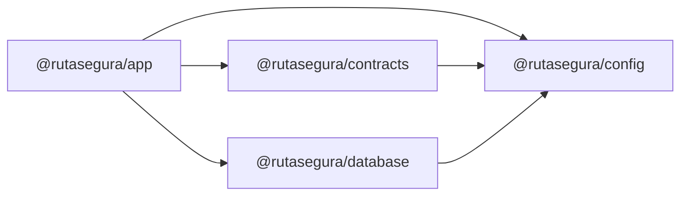

# Paquetes del workspace

El repositorio es un monorepo de pnpm con una sola aplicación ejecutable y tres paquetes compartidos. Turborepo ejecuta `lint`, `typecheck`, `test` y `build` en cada uno.

## `@rutasegura/app`

Ruta: [`apps/rutasegura`](../apps/rutasegura). La aplicación Next.js: páginas, Route Handlers, `proxy.ts` y el código de servidor.

- `next.config.ts` carga el `.env` de la raíz, genera la salida `standalone` y desactiva `X-Powered-By` y `ETag`.
- Pruebas unitarias con Vitest (`src/**/*.test.ts`) y de navegador con Playwright (`e2e/`).
- Es el único paquete que se despliega.

## `@rutasegura/contracts`

Ruta: [`packages/contracts`](../packages/contracts). Esquemas Zod y tipos compartidos entre la UI y la API.

- `healthResponseSchema` y `HealthResponse`.
- `apiErrorSchema`, `ApiErrorCode` y la tabla `API_ERRORS` con el estado HTTP y el mensaje de cada código.
- `auth.ts`: registro, login, usuario autenticado y la política de contraseña (12 a 128 caracteres, lista de contraseñas comunes).
- `tracking.ts`: consulta de guía con doble dato y su respuesta, sin datos del destinatario.
- No contiene secretos, acceso a datos ni lógica sensible: lo puede importar cualquier capa, incluidos los Client Components.

## `@rutasegura/database`

Ruta: [`packages/database`](../packages/database). Acceso a PostgreSQL con Drizzle ORM sobre el driver `postgres`.

- `getDatabase(url)` devuelve una conexión reutilizable (pool de 10, 5 s para conectar). En desarrollo se guarda en `globalThis` para que la recarga en caliente no abra pools nuevos.
- `pingDatabase(db)` ejecuta `select 1` para el health check.
- `src/schema.ts` define `users`, `sessions`, `auth_events`, `shipments` y `shipment_events`; las migraciones SQL generadas están en `drizzle/`.
- `phoneLast4Digest` (también en la subruta `@rutasegura/database/tracking-digest`) calcula el HMAC del segundo dato del rastreo; lo comparten la app y la semilla.
- `drizzle.config.ts` y los scripts `db:generate`, `db:migrate` y `db:seed` gestionan migraciones y datos ficticios. Leen el `.env` de la raíz.
- Importa `server-only`: solo el código de servidor puede usarlo.

## `@rutasegura/config`

Ruta: [`packages/config`](../packages/config). Configuración compartida.

- `tsconfig.base.json`: modo estricto con `noUncheckedIndexedAccess` y `verbatimModuleSyntax`.
- `eslint.base.mjs`: reglas recomendadas de ESLint y typescript-eslint, más `no-eval`, `no-implied-eval` y `no-new-func` como error.
- `prettier.config.mjs`: formato común, verificado en CI.

## Versiones clave

| Herramienta     | Versión              | Nota                                                            |
| --------------- | -------------------- | --------------------------------------------------------------- |
| Node.js         | 22 (`.node-version`) | Mismo runtime en Docker y CI                                    |
| pnpm            | 11.24                | Fijado en `packageManager`                                      |
| Next.js         | 16.3                 | App Router, `proxy.ts` en lugar de `middleware.ts`              |
| React           | 19.3                 |                                                                 |
| TypeScript      | 6.0                  | typescript-eslint aún no soporta TypeScript 7                   |
| ESLint          | 9.39                 | Compatibilidad con `eslint-config-next`                         |
| Zod             | 4.6                  | Contratos y validación de entorno                               |
| Drizzle ORM     | 0.45                 | Consultas parametrizadas, sin SQL concatenado                   |
| ioredis         | 6.0                  | Cliente de Redis                                                |
| @node-rs/argon2 | 2.2                  | Argon2id con binarios precompilados, sin scripts de instalación |
| jose            | 6.2                  | Firma y verificación de JWT                                     |
| tsx             | 4.23                 | Ejecuta la semilla de base de datos (desarrollo)                |
| Vitest          | 5.0                  | Pruebas unitarias                                               |
| Playwright      | 1.63                 | Pruebas en Chromium y WebKit                                    |

Todas las versiones están fijadas sin rangos (`"next": "16.3.6"`), para que cada instalación sea reproducible con `pnpm-lock.yaml`.

## Scripts de instalación

pnpm 11 bloquea por defecto los scripts `postinstall` de las dependencias, una defensa contra paquetes comprometidos. [`pnpm-workspace.yaml`](../pnpm-workspace.yaml) autoriza solo `esbuild` y `unrs-resolver`, que necesitan descargar un binario nativo. Autorizar otro paquete requiere justificarlo en la PR.
