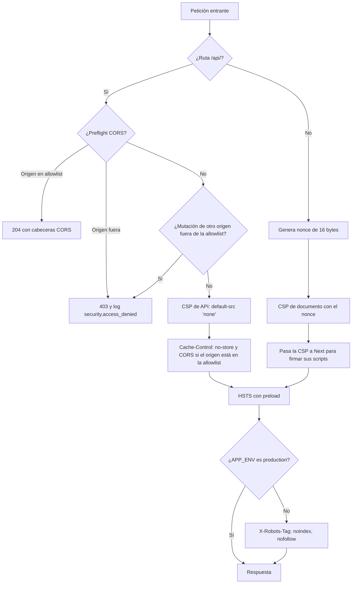

# Seguridad

RutaSegura se diseña para no repetir las debilidades del [análisis observacional del protocolo HTTP](https://app.notion.com/p/5d02fd524dd54d9882a908a2ee04bbc6) del sitio de rastreo que tomamos como referencia. Aquel análisis fue pasivo: navegación normal, lectura de cabeceras y una petición `HEAD`. Cualquier prueba activa se hace solo contra RutaSegura, en un entorno aislado y con datos ficticios.

> **Disponibilidad en WebKit y Chromium.** El hallazgo más grave del sitio de referencia no estaba en las cabeceras: su vista de rastreo se quedaba en negro en navegadores Chromium y solo funcionaba en Safari. RutaSegura trata la compatibilidad con ambos motores como un control de seguridad (disponibilidad), y cada PR la verifica en CI. Detalle y evidencia en [compatibilidad-navegadores.md](compatibilidad-navegadores.md).

## Hallazgos del sitio de referencia y controles de RutaSegura

| Hallazgo | ¿Qué se observó?                                           | Control en RutaSegura                                                                                             | ¿Dónde vive?                          |
| -------- | ---------------------------------------------------------- | ----------------------------------------------------------------------------------------------------------------- | ------------------------------------- |
| H-00     | Vista de rastreo en negro en Chromium, funcional en WebKit | Render en servidor, cero terceros, verificación en Chromium, WebKit y WebKit iPhone en cada PR                    | `layout.tsx`, `e2e/smoke.spec.ts`, CI |
| H-01     | Ambiente de pruebas público e indexable                    | `X-Robots-Tag: noindex, nofollow` en todo entorno distinto de producción                                          | `proxy.ts`                            |
| H-02     | `X-Powered-By: PHP/8.2.33`                                 | `poweredByHeader: false`                                                                                          | `next.config.ts`                      |
| H-03     | CSP con `'unsafe-inline'` y `'unsafe-eval'`                | CSP con nonce por petición y `'strict-dynamic'`; sin `unsafe-*` en producción                                     | `security-headers.ts`, `proxy.ts`     |
| H-04     | Cookies con `SameSite=None` y sin `HttpOnly`               | Cookies de sesión propias `HttpOnly; SameSite=Lax`, con `Secure` y `__Host-` sobre HTTPS; sin cookies de terceros | `server/auth/cookies.ts`              |
| H-05     | Infraestructura compartida entre pruebas y producción      | Secretos por entorno; la app no arranca en producción con valores de ejemplo                                      | `env.ts`, `startup.ts`                |
| H-06     | Seis orígenes de terceros confiados en la CSP              | Ningún origen externo en la CSP; sin scripts, fuentes ni estilos de terceros                                      | `security-headers.ts`                 |
| H-07     | `connect-src` e `img-src` con comodín `https:`             | `connect-src 'self'`; `img-src 'self' blob: data:`                                                                | `security-headers.ts`                 |
| H-08     | HSTS sin `preload`                                         | `max-age=63072000; includeSubDomains; preload` en todas las respuestas                                            | `proxy.ts`, `next.config.ts`          |
| H-09     | Sin `COOP`, `COEP` ni `CORP`                               | Las tres cabeceras en todas las respuestas; el documento queda `crossOriginIsolated`                              | `security-headers.ts`                 |
| H-10     | HTML cacheado un año en caché compartida                   | `Cache-Control: no-store` en la API; documentos renderizados por petición con `private, no-store`                 | `proxy.ts`, `layout.tsx`              |
| H-11     | Banner `server` y `ETag` expuestos                         | `generateEtags: false`; sin cabecera `Server` con producto o versión                                              | `next.config.ts`                      |
| H-12     | Política de indexación distinta entre dominios             | Una sola política, decidida por `APP_ENV`                                                                         | `proxy.ts`                            |

Los hallazgos H-03, H-04, H-06 y H-07 forman una sola cadena de ataque en el sitio de referencia: se puede inyectar un script, la cookie es legible, el destino de exfiltración está permitido y un tercero puede ser la puerta de entrada. RutaSegura rompe los cuatro eslabones a la vez.

## Autenticación y rastreo

Desde el Sprint 1, RutaSegura cubre OWASP A07 y A01 con estos controles; el detalle está en [autenticacion.md](autenticacion.md):

- Contraseñas con Argon2id (parámetros de OWASP) y política NIST de 12 a 128 caracteres.
- Bloqueo progresivo por cuenta: 5 fallos, 5 min que se duplican hasta 1 h.
- JWT HS256 de 15 min en cookie `HttpOnly`, verificado contra la sesión en cada ruta protegida; refresh token rotativo con detección de reutilización.
- Rechazo (403) de mutaciones de la API desde otro origen, además de `SameSite=Lax`.
- Rate limiting en Redis por IP, correo y guía, con 429 y `Retry-After`; falla cerrado si Redis cae.
- Respuestas idénticas para cuenta inexistente, contraseña incorrecta y cuenta bloqueada, y para guía inexistente y segundo dato incorrecto.
- Rastreo con número de guía y últimos 4 dígitos del teléfono, guardados como HMAC.
- Bitácora `auth_events` sin datos personales en claro.

**Requisito de despliegue:** la app debe ir detrás de un proxy que sobrescriba o extienda `X-Forwarded-For` (Vercel, nginx, Caddy). Sin él, el límite por IP es evadible; los límites por correo y por guía y el bloqueo por cuenta no dependen de la IP.

## Autorización por objeto

Desde la Phase 9 la API de envíos ([api.md](api.md#envíos-y-agenda)) cubre OWASP A01 (IDOR) y A09 con estas capas:

| Capa               | Control                                                                                                                                                    | ¿Dónde vive?                                |
| ------------------ | ---------------------------------------------------------------------------------------------------------------------------------------------------------- | ------------------------------------------- |
| Identidad          | El dueño sale de `authenticate()`; los contratos `.strict()` rechazan `ownerId` y `userId`                                                                 | `require-user.ts`, `contracts/shipments.ts` |
| Autorización       | `assertOwnership({ ownerId }, userId)` por igualdad exacta en cada lectura y escritura; `ownerId` nulo no es de nadie                                      | `server/authorization/ownership.ts`         |
| Respuesta uniforme | Ajeno, inexistente o mal formado: `404 not_found`, nunca `403`, también en `DELETE .../schedule`. `OwnershipError` se traduce a 404 en `withErrorHandling` | `server/http/guards.ts`                     |
| Identificadores    | ULID de 128 bits (80 aleatorios, `crypto.randomBytes`) en la API; el UUID interno no sale del servidor                                                     | `server/ids/ulid.ts`                        |
| Reclamo            | Guía más últimos 4 dígitos, con el mismo HMAC y los mismos límites que el rastreo; guía de otro usuario responde 404                                       | `services/shipments.ts`                     |
| RLS en PostgreSQL  | Políticas sobre `owner_id = app.user_id` en `shipments`; eventos, bitácora y avisos heredan la visibilidad del envío o del usuario                         | migración `0001_shipments_agenda.sql`       |
| Bitácora           | `shipment_audit_events`: `claimed`, `scheduled`, `rescheduled`, `unscheduled`, `status_changed`, con actor por id interno; sin IP, correo, guía ni nombre  | `repositories/shipments.ts`                 |
| Avisos             | Cuerpo fijo sin guía, ULID, nombre, teléfono, dirección, ciudad ni franja                                                                                  | `server/notifications/simulate.ts`          |
| Lectura de avisos  | `GET /api/v1/notifications` y `POST /read` filtran por el usuario de la sesión; sin identificadores en la URL y parámetros extra con 400                   | `services/notifications.ts`                 |
| Rate limit         | 60 peticiones por minuto por usuario (clave con HMAC del id) para envíos y, por separado, para avisos                                                      | `rate-limit/policies.ts`                    |

### RLS como defensa en profundidad

Cada petición abre una transacción y fija `app.user_id` y, cuando aplica, `app.mode` con `set_config(..., true)` (equivalente a `SET LOCAL`): el valor muere con la transacción y no pasa a otra petición que reutilice la conexión del pool.

| `app.mode`        | ¿Quién lo usa?                                  | ¿Qué permite?                                                               |
| ----------------- | ----------------------------------------------- | --------------------------------------------------------------------------- |
| _(vacío)_         | Listar, consultar, agendar y cancelar la agenda | Solo filas con `owner_id = app.user_id`                                     |
| `public_tracking` | `services/tracking.ts`                          | `SELECT` de envíos y eventos; el filtro por guía y dígitos lo hace la app   |
| `claim`           | Reclamo                                         | `SELECT` por guía y `UPDATE` solo si `owner_id IS NULL` y queda como propio |
| `operator`        | `transitionShipmentStatus`                      | Cambio de estado, evento de rastreo y aviso al dueño                        |

En `notifications`, `SELECT` y `UPDATE` (marcar como leído) exigen `user_id = app.user_id` en `USING` y en `WITH CHECK`: otro usuario no puede marcar ni reasignarse avisos ajenos. Verificado con un rol no dueño.

El control que cuenta en la API es `assertOwnership`; la RLS evita que un error en una consulta futura exponga filas ajenas. Límites conocidos:

- **PostgreSQL no aplica RLS al dueño de la tabla** (salvo `FORCE ROW LEVEL SECURITY`). En Compose el rol `rutasegura` es dueño, así que en desarrollo las políticas no se ejercitan. En producción el runtime debe conectarse con un rol **no dueño** con `SELECT`, `INSERT` y `UPDATE` sobre estas tablas, y las migraciones con otro rol dueño.
- `app.user_id` y `app.mode` los fija la aplicación: protegen contra errores de la app, no contra quien ya tenga una conexión a la base.

### Retención

`shipment_audit_events` y `notifications` se conservan 365 días. En este sprint no hay tarea de purga; queda pendiente para el hardening.

## Documentos y almacenamiento

Desde el Sprint 3 los soportes de los envíos viven en un bucket privado (OWASP A05) y solo se descargan con una URL firmada de 60 s que la app emite al dueño (A01). Detalle y evidencia reproducible en [documentos.md](documentos.md).

| Capa          | Control                                                                                                         | ¿Dónde vive?                    |
| ------------- | --------------------------------------------------------------------------------------------------------------- | ------------------------------- |
| Bucket        | Sin política anónima: GET y listados sin firma responden 403                                                    | `scripts/minio-init.sh`         |
| Credenciales  | La app firma con una cuenta `readonly`; la root solo la usan los contenedores                                   | `compose.yaml`, `minio-init.sh` |
| Autorización  | `assertOwnership` antes de firmar; ajeno, inexistente o mal formado: el mismo 404                               | `services/documents.ts`         |
| Firma         | SigV4 con TTL de 60 s (máximo 300), `attachment` y `no-store` firmados; la API nunca expone la clave del objeto | `server/storage/signer.ts`      |
| Configuración | En producción el almacenamiento es obligatorio, sin valores de ejemplo y con endpoint HTTPS                     | `env.ts`                        |
| Bitácora      | `document_url_issued` por cada emisión, con actor; la URL nunca se registra                                     | `services/documents.ts`         |
| Rate limit    | 30 emisiones o listados por usuario por minuto                                                                  | `rate-limit/policies.ts`        |
| RLS           | `documents_select` hereda la visibilidad del envío                                                              | migración `0004_documents.sql`  |

## Recorrido de una petición

[`proxy.ts`](../apps/rutasegura/src/proxy.ts) se ejecuta en toda petición salvo los recursos estáticos de `_next` y las precargas de navegación.



Las cabeceras fijas (`Strict-Transport-Security`, `X-Content-Type-Options`, `X-Frame-Options`, `Permissions-Policy`, COOP, COEP, CORP y demás) las añade `next.config.ts` a todas las rutas, incluidos los recursos estáticos que el proxy no procesa. `upgrade-insecure-requests` sigue emitiéndose solo cuando la petición llega por HTTPS.

## Política de seguridad de contenido

La CSP de los documentos se construye en [`security-headers.ts`](../apps/rutasegura/src/lib/security-headers.ts). En producción es:

```text
default-src 'self';
script-src 'self' 'nonce-<aleatorio>' 'strict-dynamic';
style-src 'self' 'nonce-<aleatorio>';
img-src 'self' blob: data:;
font-src 'self';
connect-src 'self';
object-src 'none';
base-uri 'self';
form-action 'self';
frame-ancestors 'none';
frame-src 'none';
worker-src 'self';
manifest-src 'self';
upgrade-insecure-requests
```

| Directiva                                   | ¿Por qué?                                                                                                                             |
| ------------------------------------------- | ------------------------------------------------------------------------------------------------------------------------------------- |
| `script-src` con nonce y `'strict-dynamic'` | Solo corren los scripts que Next firma con el nonce de esa petición. Un script inyectado no conoce el nonce y el navegador lo bloquea |
| `style-src` con nonce                       | Sin estilos en línea arbitrarios. Los estilos van en hojas CSS propias                                                                |
| `connect-src 'self'`                        | Un script comprometido no puede enviar datos a otro dominio                                                                           |
| `object-src 'none'`, `frame-src 'none'`     | Sin plugins ni iframes                                                                                                                |
| `frame-ancestors 'none'`                    | Nadie puede incrustar RutaSegura en un iframe (clickjacking)                                                                          |
| `base-uri 'self'`, `form-action 'self'`     | Impide redirigir rutas relativas o formularios a otro dominio                                                                         |
| `upgrade-insecure-requests`                 | Solo sobre HTTPS; ver [compatibilidad-navegadores.md](compatibilidad-navegadores.md)                                                  |

El nonce se genera con `crypto.getRandomValues` en cada petición, así que ningún documento se puede servir desde caché con un nonce viejo.

En desarrollo, y solo ahí, la CSP añade `'unsafe-eval'` en scripts y `'unsafe-inline'` en estilos: React usa `eval` para reconstruir trazas de error y la recarga en caliente de Next inyecta estilos sin nonce. La imagen de producción no los incluye, y una prueba unitaria lo verifica.

## Cabeceras comunes

| Cabecera                       | Valor                                                                                |
| ------------------------------ | ------------------------------------------------------------------------------------ |
| `X-Content-Type-Options`       | `nosniff`                                                                            |
| `X-Frame-Options`              | `DENY`                                                                               |
| `Referrer-Policy`              | `strict-origin-when-cross-origin`                                                    |
| `Permissions-Policy`           | Deniega cámara, micrófono, geolocalización, pagos, USB, sensores y `browsing-topics` |
| `Cross-Origin-Opener-Policy`   | `same-origin`                                                                        |
| `Cross-Origin-Embedder-Policy` | `require-corp`                                                                       |
| `Cross-Origin-Resource-Policy` | `same-origin`                                                                        |
| `Origin-Agent-Cluster`         | `?1`                                                                                 |
| `X-DNS-Prefetch-Control`       | `off`                                                                                |
| `Strict-Transport-Security`    | `max-age=63072000; includeSubDomains; preload`, en todas las respuestas              |

HSTS se emite también sobre HTTP porque el navegador lo ignora si no llega por HTTPS ([RFC 6797 §8.1](https://www.rfc-editor.org/rfc/rfc6797#section-8.1)). Así se cumple "en todas las respuestas" sin fijar HSTS en `http://localhost`. Lo verifican `proxy.test.ts` (documento por HTTP y HTTPS, API y 403) y `security-headers.test.ts` (estáticos).

## CORS

La API (`/api/*`) aplica CORS con una allowlist de orígenes exactos, en [`cors.ts`](../apps/rutasegura/src/lib/cors.ts) y [`proxy.ts`](../apps/rutasegura/src/proxy.ts).

### Allowlist

| Origen                                 | ¿Cuándo?                                                            |
| -------------------------------------- | ------------------------------------------------------------------- |
| Origen de `NEXT_PUBLIC_APP_URL`        | Siempre. El portal y la UI pública (S10) viven en la misma app Next |
| Cada entrada de `CORS_ALLOWED_ORIGINS` | Solo si se configura. Por defecto la variable está vacía            |

Reglas de `CORS_ALLOWED_ORIGINS`, validadas en [`env.ts`](../apps/rutasegura/src/server/env.ts) al arrancar (la app no arranca si la lista es inválida):

- Lista separada por comas de orígenes exactos (`https://portal.example.org`), comparados por igualdad, sin normalizar subdominios.
- Sin `*` ni comodines de subdominio: con credenciales, `*` no es válido y abriría la API a cualquier sitio.
- Sin ruta, query ni fragmento.
- Solo `http` o `https`; con `APP_ENV=production`, solo `https`.

Estado actual por entorno:

| Entorno    | `CORS_ALLOWED_ORIGINS` | Orígenes permitidos                |
| ---------- | ---------------------- | ---------------------------------- |
| Desarrollo | vacío                  | `http://localhost:3000`            |
| Preview    | vacío                  | El origen de la URL de preview     |
| Producción | vacío                  | El origen de `NEXT_PUBLIC_APP_URL` |

Cualquier origen nuevo se añade aquí y en la variable del entorno, con el motivo.

### Comportamiento

| Petición                                                                            | Respuesta                                                                                                                                                                                 |
| ----------------------------------------------------------------------------------- | ----------------------------------------------------------------------------------------------------------------------------------------------------------------------------------------- |
| Preflight (`OPTIONS` con `Access-Control-Request-Method`) desde un origen permitido | `204` con `Access-Control-Allow-Origin` exacto, `Allow-Credentials: true`, `Allow-Methods: GET, POST, PUT, PATCH, DELETE`, `Allow-Headers: Content-Type`, `Max-Age: 600` y `Vary: Origin` |
| Preflight desde un origen no permitido                                              | `403 forbidden` y log `security.access_denied` con motivo `cors_origin_rejected`                                                                                                          |
| Lectura desde un origen permitido                                                   | Respuesta normal con `Access-Control-Allow-Origin` exacto y `Vary: Origin`                                                                                                                |
| Lectura desde un origen no permitido                                                | Respuesta sin cabeceras CORS: el navegador no deja leerla                                                                                                                                 |
| Mutación desde un origen no permitido                                               | `403 forbidden` (defensa CSRF) y log con motivo `cross_site_mutation`                                                                                                                     |

Nunca se responde `Access-Control-Allow-Origin: *`. Las cookies de sesión siguen siendo `SameSite=Lax`, así que un origen de otro sitio no recibe la sesión aunque esté en la allowlist. El CORS del bucket de las URLs firmadas se configura en el proveedor de almacenamiento, no en la app.

## Protección contra inyección SQL

Ninguna consulta se arma concatenando strings. Todo el acceso a datos pasa por Drizzle ORM:

- El query builder (`select`, `insert`, `update`, `eq`, `and`, `notInArray`…) envía cada valor como parámetro `$n` del protocolo extendido de PostgreSQL (`postgres` con `prepare: true`).
- La etiqueta `` sql`...${valor}` `` también convierte cada `${valor}` en parámetro. Solo interpola columnas del esquema y valores, nunca texto SQL.

### Inventario de SQL escrito a mano

| Archivo                           | Consulta                                                                                       | ¿Qué se parametriza?                      |
| --------------------------------- | ---------------------------------------------------------------------------------------------- | ----------------------------------------- |
| `repositories/db.ts`              | `select set_config('app.user_id', ${userId}, true), set_config('app.mode', ${mode}, true)`     | `userId` y `mode` como `$1` y `$2`        |
| `repositories/users.ts`           | `failed_login_count + 1`, `lockout_level + 1`, `now() + make_interval(secs => ${lockSeconds})` | `lockSeconds`; el resto son columnas      |
| `repositories/sessions.ts`        | `expires_at > now()`, `revoked_at = now()`                                                     | Sin valores externos                      |
| `repositories/notifications.ts`   | `read_at = now()`                                                                              | Sin valores externos                      |
| `repositories/shipments.ts`       | `coalesce(public_id, ${publicId})`                                                             | `publicId` (ULID generado en el servidor) |
| `packages/database/src/index.ts`  | `select 1` (health check)                                                                      | Sin valores                               |
| `packages/database/src/schema.ts` | `CHECK` y políticas RLS                                                                        | DDL de migración; sin datos de peticiones |

**Único `sql.raw`:** `shipmentVisible` en `schema.ts` arma la subconsulta de visibilidad de las políticas RLS. Solo acepta el tipo literal cerrado `"shipment_events.shipment_id" | "shipment_audit_events.shipment_id" | "documents.shipment_id"`, así que TypeScript impide que le llegue un dato de una petición. Solo se usa al generar migraciones.

### Controles automáticos

| Control                       | ¿Qué hace?                                                                                                                                                                                                                                                                                                    | ¿Dónde vive?                                                           |
| ----------------------------- | ------------------------------------------------------------------------------------------------------------------------------------------------------------------------------------------------------------------------------------------------------------------------------------------------------------- | ---------------------------------------------------------------------- |
| ESLint `no-restricted-syntax` | Falla el lint con `sql.raw(...)`, cualquier `.unsafe(...)` y `execute()`/`query()` que reciban un string, un template literal sin etiqueta o una concatenación. La excepción de `schema.ts` lleva un `eslint-disable` justificado                                                                             | `packages/config/eslint.sql.mjs`, aplicado en la app y en los paquetes |
| Prueba de parametrización     | Ejecuta los repositorios reales contra Drizzle sin conexión con cargas como `' OR 1=1 --` y `'; DROP TABLE users; --`, y verifica que la carga no aparezca en el texto SQL y sí en los parámetros `$n`. Cubre correo, id, guía, `publicId`, documentos (`publicId`, envío y dueño), `coalesce` y `set_config` | `apps/rutasegura/src/server/repositories/sql-injection.test.ts`        |
| Validación de entrada         | Contratos Zod en cada endpoint; ULID, correo y guía se validan antes de llegar a la base                                                                                                                                                                                                                      | `packages/contracts`                                                   |

## Logging de seguridad

Todos los eventos salen por [`logger.ts`](../apps/rutasegura/src/server/logger.ts) como JSON de una línea, con nivel `warn`, a `stderr`.

| Evento                   | ¿Cuándo?                                                                                                        | Campos                                                                                              | ¿Dónde se emite?                |
| ------------------------ | --------------------------------------------------------------------------------------------------------------- | --------------------------------------------------------------------------------------------------- | ------------------------------- |
| `security.auth_failure`  | Cada 401 de una ruta protegida o de `refresh`                                                                   | `route`, `method`, `reason`, `ipHash`                                                               | `requireUser()`, `auth/refresh` |
| `security.auth_failure`  | Página del portal con cookie de acceso inválida, vencida o de una sesión revocada (antes de redirigir al login) | `source: "page"`, `route` (sin IDs, p. ej. `page:/portal/envios/:id`), `method`, `reason`, `ipHash` | `requirePortalUser()`           |
| `security.access_denied` | 404 por recurso ajeno o inexistente (`ownership`)                                                               | `route`, `method`, `reason`, `ipHash`                                                               | `withErrorHandling()`           |
| `security.access_denied` | 404 de una página del portal por envío ajeno (`ownership`)                                                      | `source: "page"`, `route`, `reason`                                                                 | `loadOwnedShipment()`           |
| `security.access_denied` | 403 por mutación cross-site o preflight CORS rechazado                                                          | `source: "proxy"`, `route`, `method`, `reason`                                                      | `proxy.ts`                      |
| `security.auth_event`    | `login_failure`, `login_locked`, `account_locked`, `refresh_reuse`, `rate_limited`, `tracking_failure`          | `type`, `userId` (id interno o `null`)                                                              | `recordAuthEvent()`             |

Motivos de `security.auth_failure`: `missing_token`, `invalid_token` (firma, emisor o vencimiento), `session_inactive` (logout o sesión revocada), `user_not_found` y `refresh_invalid`. Motivos de `security.access_denied`: `ownership`, `cross_site_mutation` y `cors_origin_rejected`.

Una visita al portal sin cookie no se registra: es alguien sin sesión, no un intento fallido.

El motivo solo va al log. Al cliente se le responde siempre el mismo `401 unauthorized`, `403 forbidden` o `404 not_found`, para no crear un oráculo. Los eventos de `security.auth_event` se siguen guardando también en la tabla `auth_events`.

**Nunca se registran:** contraseñas, tokens JWT o de refresh, cookies, cabecera `Authorization`, correo, teléfono, número de guía, nombre, dirección, IP en claro, cuerpos de petición ni mensajes de error crudos (`errorKind()` los reduce a su nombre). La IP va como HMAC-SHA256 con `HMAC_SECRET` y el propósito `log-ip`: sirve para correlacionar intentos de una misma fuente sin guardar la IP. El proxy no tiene acceso a los secretos, así que sus eventos no llevan IP.

Como segunda barrera, `logger.ts` sustituye por `[redacted]` cualquier campo, también anidado, cuya clave coincida con `password`, `token`, `cookie`, `authorization`, `secret`, `email`, `phone`, `tracking`, `guia`, `name`, `recipient`, `address` o `ip`. Lo verifican `logger.test.ts`, `require-user.test.ts`, `guards.test.ts`, `auth-events.test.ts` y `proxy.test.ts`.

## Verificación con el frontend (Sprint 3)

Los criterios que dependían de la UI real se cierran con los flujos E2E de [`e2e-flows`](../apps/rutasegura/e2e-flows), que recorren registro, login, reclamo, agenda, descarga firmada, 404 y logout en Chromium y WebKit contra el entorno Docker completo:

| Criterio                           | ¿Cómo quedó?                                                                                                                                                                                                                                                      |
| ---------------------------------- | ----------------------------------------------------------------------------------------------------------------------------------------------------------------------------------------------------------------------------------------------------------------- |
| CSP contra la app real             | El flujo falla ante cualquier error de consola, violaciones de CSP incluidas. La UI no usa estilos en línea (CSS Modules), la fuente Inter se sirve desde el propio origen con `next/font` y `buildDocumentPolicy` no cambió: sin `unsafe-*` ni orígenes externos |
| Mitigación de XSS (encoding + CSP) | Sin `dangerouslySetInnerHTML` (`react/no-danger`). El flujo registra un nombre con `` y comprueba que se muestra como texto, que no se crea el elemento y que el manejador no se ejecuta                                                     |
| CORS de punta a punta              | La UI llama a la API en el mismo origen con rutas relativas. La descarga es una navegación de primer nivel a la URL firmada, no un `fetch`: no requiere CORS en el bucket ni ampliar `connect-src` o `img-src`                                                    |

### Después de la integración FE↔BE

El smoke de UI ([smoke-ui.md](smoke-ui.md)) corre contra la **imagen de producción** (`APP_BUILD_TARGET=runner`), no contra `next dev`, cuya CSP añade `unsafe-eval` y `unsafe-inline` para la recarga en caliente. En cada página pública y del portal comprueba:

- CSP con `script-src 'self' 'nonce-…' 'strict-dynamic'`, `style-src 'self' 'nonce-…'`, `frame-ancestors 'none'` y sin ningún `unsafe-*`.
- HSTS `max-age=63072000; includeSubDomains; preload` y `X-Content-Type-Options: nosniff`.
- Ningún error de CSP, JavaScript ni hidratación en la consola.

Errores visibles al usuario:

- Todos los textos salen de un solo catálogo, [`error-messages.ts`](../apps/rutasegura/src/lib/error-messages.ts): un mensaje por código de la API (los mismos de `API_ERRORS`) y variantes por pantalla que no revelan si una guía o una cuenta existen. Un código desconocido se muestra como `internal_error`.
- Los error boundaries (`app/error.tsx`, `app/(portal)/portal/error.tsx` y `app/global-error.tsx`) muestran "Algo salió mal", un botón para reintentar y el `digest` como código de referencia. Nunca muestran `error.message` ni la traza.
- Las cargas de datos de las páginas pasan por [`pageData()`](../apps/rutasegura/src/server/portal/page-data.ts): `redirect` y `notFound` siguen su curso y cualquier otro fallo se registra como `page.unhandled_error` (`route` y `kind`) y se relanza como `PageDataError` sin detalles. Sin esto, Next imprimía en stderr el error de Drizzle con la consulta y sus parámetros, incluido el ID de sesión (defecto DEF-01 de [smoke-ui.md](smoke-ui.md)).
- El smoke detiene PostgreSQL y verifica la página genérica, el `500 internal_error` de la API y que el log del contenedor no tenga la consulta, sus parámetros ni `ENOTFOUND`.

## Configuración y secretos

- Solo se versiona `.env.example`. `.env` y sus variantes están en `.gitignore` y en `.dockerignore`.
- [`env.ts`](../apps/rutasegura/src/server/env.ts) valida todas las variables con Zod: URLs con protocolo esperado (`postgres`, `redis`), secretos de al menos 32 caracteres y vigencia de URL firmada de 300 s como máximo.
- Con `APP_ENV=production`, la validación además rechaza secretos que conserven valores de ejemplo y una `NEXT_PUBLIC_APP_URL` sin HTTPS.
- La validación corre al arrancar ([`startup.ts`](../apps/rutasegura/src/server/startup.ts)). Si falla, el proceso termina con código 1, para que el orquestador lo marque como caído en lugar de dejar un servidor mal configurado atendiendo peticiones.
- El error de validación nombra las variables inválidas y nunca muestra sus valores.

## Errores y logs

- Los errores de la API tienen un mensaje fijo por código ([api.md](api.md#códigos-de-error)): casos equivalentes responden igual, sin trazas ni detalles internos.
- [`logger.ts`](../apps/rutasegura/src/server/logger.ts) escribe JSON con metadatos (evento, dependencia, tipo de error). `errorKind()` reduce cada error a su nombre, porque el mensaje de un error de conexión puede contener la cadena de conexión.

## Contenedores

- La imagen de producción corre como el usuario `nextjs` (uid 1001), no como root.
- Compose publica PostgreSQL, Redis y MinIO solo en `127.0.0.1`, nunca en la red local. La consola web de MinIO está apagada.
- Las credenciales de `compose.yaml` son locales y de ejemplo; producción usa servicios administrados con secretos propios.

## Controles pendientes

| Control                                                                 | Riesgo OWASP | Phase      |
| ----------------------------------------------------------------------- | ------------ | ---------- |
| TOTP opcional como segundo factor                                       | A07          | 8          |
| Rol de base de datos no dueño en producción, para que la RLS se aplique | A01          | Despliegue |
| Purga de `shipment_audit_events` y `notifications` a los 365 días       | A09          | 14 a 17    |
| Checklist ASVS L1, pentesting y re-test antes/después                   | Todas        | 14 a 17    |

## Cómo verificarlo

```bash
curl -sI https://<dominio>/            # CSP con nonce, COOP, COEP, CORP, HSTS
curl -si https://<dominio>/api/v1/health
curl -sI http://localhost:3000/ | grep -i strict-transport-security   # HSTS también por HTTP

# Preflight CORS permitido (204 con Access-Control-Allow-Origin exacto)
curl -si -X OPTIONS http://localhost:3000/api/v1/shipments \
  -H "Origin: http://localhost:3000" -H "Access-Control-Request-Method: POST"
# Preflight CORS rechazado (403 y log security.access_denied)
curl -si -X OPTIONS http://localhost:3000/api/v1/shipments \
  -H "Origin: https://atacante.example" -H "Access-Control-Request-Method: POST"

# Log de auth failure: 401 y línea security.auth_failure con reason=missing_token
curl -si http://localhost:3000/api/v1/auth/me
docker compose logs rutasegura | grep security.

pnpm lint                              # Incluye la regla contra sql.raw y SQL en strings
pnpm test                              # CSP, proxy, entorno, health check, auth y rate limit
pnpm test:e2e                          # Chromium, WebKit y WebKit iPhone
pnpm test:smoke                        # Autenticación, rastreo, agenda, avisos y documentos (IDOR) contra Docker
pnpm test:e2e:flows                    # Flujos de UI en Chromium y WebKit contra Docker
pnpm test:smoke:ui                     # Los mismos flujos contra la imagen de producción (CSP estricta)
./scripts/evidence-signed-urls.sh      # Evidencia de bucket privado y vencimiento de la URL firmada
```
