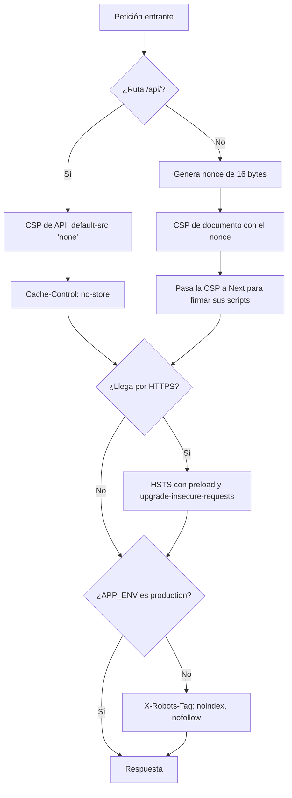

# Seguridad

RutaSegura se diseña para no repetir las debilidades del [análisis observacional del protocolo HTTP](https://app.notion.com/p/5d02fd524dd54d9882a908a2ee04bbc6) del sitio de rastreo que tomamos como referencia. Aquel análisis fue pasivo: navegación normal, lectura de cabeceras y una petición `HEAD`. Cualquier prueba activa se hace solo contra RutaSegura, en un entorno aislado y con datos ficticios.

> **Disponibilidad en WebKit y Chromium.** El hallazgo más grave del sitio de referencia no estaba en las cabeceras: su vista de rastreo se quedaba en negro en navegadores Chromium y solo funcionaba en Safari. RutaSegura trata la compatibilidad con ambos motores como un control de seguridad (disponibilidad), y cada PR la verifica en CI. Detalle y evidencia en [compatibilidad-navegadores.md](compatibilidad-navegadores.md).

## Hallazgos del sitio de referencia y controles de RutaSegura

| Hallazgo | Qué se observó                                             | Control en RutaSegura                                                                                             | Dónde vive                            |
| -------- | ---------------------------------------------------------- | ----------------------------------------------------------------------------------------------------------------- | ------------------------------------- |
| H-00     | Vista de rastreo en negro en Chromium, funcional en WebKit | Render en servidor, cero terceros, verificación en Chromium, WebKit y WebKit iPhone en cada PR                    | `layout.tsx`, `e2e/smoke.spec.ts`, CI |
| H-01     | Ambiente de pruebas público e indexable                    | `X-Robots-Tag: noindex, nofollow` en todo entorno distinto de producción                                          | `proxy.ts`                            |
| H-02     | `X-Powered-By: PHP/8.2.33`                                 | `poweredByHeader: false`                                                                                          | `next.config.ts`                      |
| H-03     | CSP con `'unsafe-inline'` y `'unsafe-eval'`                | CSP con nonce por petición y `'strict-dynamic'`; sin `unsafe-*` en producción                                     | `security-headers.ts`, `proxy.ts`     |
| H-04     | Cookies con `SameSite=None` y sin `HttpOnly`               | Cookies de sesión propias `HttpOnly; SameSite=Lax`, con `Secure` y `__Host-` sobre HTTPS; sin cookies de terceros | `server/auth/cookies.ts`              |
| H-05     | Infraestructura compartida entre pruebas y producción      | Secretos por entorno; la app no arranca en producción con valores de ejemplo                                      | `env.ts`, `startup.ts`                |
| H-06     | Seis orígenes de terceros confiados en la CSP              | Ningún origen externo en la CSP; sin scripts, fuentes ni estilos de terceros                                      | `security-headers.ts`                 |
| H-07     | `connect-src` e `img-src` con comodín `https:`             | `connect-src 'self'`; `img-src 'self' blob: data:`                                                                | `security-headers.ts`                 |
| H-08     | HSTS sin `preload`                                         | `max-age=63072000; includeSubDomains; preload` sobre HTTPS                                                        | `proxy.ts`                            |
| H-09     | Sin `COOP`, `COEP` ni `CORP`                               | Las tres cabeceras en todas las respuestas; el documento queda `crossOriginIsolated`                              | `security-headers.ts`                 |
| H-10     | HTML cacheado un año en caché compartida                   | `Cache-Control: no-store` en la API; documentos renderizados por petición con `private, no-store`                 | `proxy.ts`, `layout.tsx`              |
| H-11     | Banner `server` y `ETag` expuestos                         | `generateEtags: false`; sin cabecera `Server` con producto o versión                                              | `next.config.ts`                      |
| H-12     | Política de indexación distinta entre dominios             | Una sola política, decidida por `APP_ENV`                                                                         | `proxy.ts`                            |

Los hallazgos H-03, H-04, H-06 y H-07 forman una sola cadena de ataque en el sitio de referencia: se puede inyectar un script, la cookie es legible, el destino de exfiltración está permitido y un tercero puede ser la puerta de entrada. RutaSegura rompe los cuatro eslabones a la vez.

## Autenticación y rastreo

Desde el Sprint 1, RutaSegura cubre OWASP A07 y A01 con estos controles; el detalle está en [autenticacion.md](autenticacion.md):

- Contraseñas con Argon2id (parámetros de OWASP) y política NIST de 12 a 128 caracteres.
- Bloqueo progresivo por cuenta: 5 fallos, 5 min que se duplican hasta 1 h.
- JWT HS256 de 15 min en cookie `HttpOnly`, verificado contra la sesión en cada ruta protegida; refresh token rotativo con detección de reutilización.
- Rechazo (403) de mutaciones de la API desde otro origen, además de `SameSite=Lax`.
- Rate limiting en Redis por IP, correo y guía, con 429 y `Retry-After`; falla cerrado si Redis cae.
- Respuestas idénticas para cuenta inexistente, contraseña incorrecta y cuenta bloqueada, y para guía inexistente y segundo dato incorrecto.
- Rastreo con número de guía y últimos 4 dígitos del teléfono, guardados como HMAC.
- Bitácora `auth_events` sin datos personales en claro.

**Requisito de despliegue:** la app debe ir detrás de un proxy que sobrescriba o extienda `X-Forwarded-For` (Vercel, nginx, Caddy). Sin él, el límite por IP es evadible; los límites por correo y por guía y el bloqueo por cuenta no dependen de la IP.

## Autorización por objeto

Desde la Phase 9 la API de envíos ([api.md](api.md#envíos-y-agenda)) cubre OWASP A01 (IDOR) y A09 con estas capas:

| Capa               | Control                                                                                                                                    | Dónde vive                                  |
| ------------------ | ------------------------------------------------------------------------------------------------------------------------------------------ | ------------------------------------------- |
| Identidad          | El dueño sale de `authenticate()`; los contratos `.strict()` rechazan `ownerId` y `userId`                                                 | `require-user.ts`, `contracts/shipments.ts` |
| Autorización       | `assertOwnership({ ownerId }, userId)` por igualdad exacta en cada lectura y escritura; `ownerId` nulo no es de nadie                      | `server/authorization/ownership.ts`         |
| Respuesta uniforme | Ajeno, inexistente o mal formado: `404 not_found`, nunca `403`. `OwnershipError` se traduce a 404 en `withErrorHandling`                   | `server/http/guards.ts`                     |
| Identificadores    | ULID de 128 bits (80 aleatorios, `crypto.randomBytes`) en la API; el UUID interno no sale del servidor                                     | `server/ids/ulid.ts`                        |
| Reclamo            | Guía más últimos 4 dígitos, con el mismo HMAC y los mismos límites que el rastreo; guía de otro usuario responde 404                       | `services/shipments.ts`                     |
| RLS en PostgreSQL  | Políticas sobre `owner_id = app.user_id` en `shipments`; eventos, bitácora y avisos heredan la visibilidad del envío o del usuario         | migración `0001_shipments_agenda.sql`       |
| Bitácora           | `shipment_audit_events`: `claimed`, `scheduled`, `rescheduled`, `status_changed`, con actor por id interno; sin IP, correo, guía ni nombre | `repositories/shipments.ts`                 |
| Avisos             | Cuerpo fijo sin guía, ULID, nombre, teléfono, dirección, ciudad ni franja                                                                  | `server/notifications/simulate.ts`          |
| Lectura de avisos  | `GET /api/v1/notifications` y `POST /read` filtran por el usuario de la sesión; sin identificadores en la URL y parámetros extra con 400   | `services/notifications.ts`                 |
| Rate limit         | 60 peticiones por minuto por usuario (clave con HMAC del id) para envíos y, por separado, para avisos                                      | `rate-limit/policies.ts`                    |

### RLS como defensa en profundidad

Cada petición abre una transacción y fija `app.user_id` y, cuando aplica, `app.mode` con `set_config(..., true)` (equivalente a `SET LOCAL`): el valor muere con la transacción y no pasa a otra petición que reutilice la conexión del pool.

| `app.mode`        | Quién lo usa                | Qué permite                                                                 |
| ----------------- | --------------------------- | --------------------------------------------------------------------------- |
| _(vacío)_         | Listar, consultar y agendar | Solo filas con `owner_id = app.user_id`                                     |
| `public_tracking` | `services/tracking.ts`      | `SELECT` de envíos y eventos; el filtro por guía y dígitos lo hace la app   |
| `claim`           | Reclamo                     | `SELECT` por guía y `UPDATE` solo si `owner_id IS NULL` y queda como propio |
| `operator`        | `transitionShipmentStatus`  | Cambio de estado, evento de rastreo y aviso al dueño                        |

En `notifications`, `SELECT` y `UPDATE` (marcar como leído) exigen `user_id = app.user_id` en `USING` y en `WITH CHECK`: otro usuario no puede marcar ni reasignarse avisos ajenos. Verificado con un rol no dueño.

El control que cuenta en la API es `assertOwnership`; la RLS evita que un error en una consulta futura exponga filas ajenas. Límites conocidos:

- **PostgreSQL no aplica RLS al dueño de la tabla** (salvo `FORCE ROW LEVEL SECURITY`). En Compose el rol `rutasegura` es dueño, así que en desarrollo las políticas no se ejercitan. En producción el runtime debe conectarse con un rol **no dueño** con `SELECT`, `INSERT` y `UPDATE` sobre estas tablas, y las migraciones con otro rol dueño.
- `app.user_id` y `app.mode` los fija la aplicación: protegen contra errores de la app, no contra quien ya tenga una conexión a la base.

### Retención

`shipment_audit_events` y `notifications` se conservan 365 días. En este sprint no hay tarea de purga; queda pendiente para el hardening.

## Recorrido de una petición

[`proxy.ts`](../apps/rutasegura/src/proxy.ts) se ejecuta en toda petición salvo los recursos estáticos de `_next` y las precargas de navegación.



Las cabeceras fijas (`X-Content-Type-Options`, `X-Frame-Options`, `Permissions-Policy`, COOP, COEP, CORP y demás) las añade `next.config.ts` a todas las rutas, incluidos los recursos estáticos.

## Política de seguridad de contenido

La CSP de los documentos se construye en [`security-headers.ts`](../apps/rutasegura/src/lib/security-headers.ts). En producción es:

```text
default-src 'self';
script-src 'self' 'nonce-<aleatorio>' 'strict-dynamic';
style-src 'self' 'nonce-<aleatorio>';
img-src 'self' blob: data:;
font-src 'self';
connect-src 'self';
object-src 'none';
base-uri 'self';
form-action 'self';
frame-ancestors 'none';
frame-src 'none';
worker-src 'self';
manifest-src 'self';
upgrade-insecure-requests
```

| Directiva                                   | Por qué                                                                                                                               |
| ------------------------------------------- | ------------------------------------------------------------------------------------------------------------------------------------- |
| `script-src` con nonce y `'strict-dynamic'` | Solo corren los scripts que Next firma con el nonce de esa petición. Un script inyectado no conoce el nonce y el navegador lo bloquea |
| `style-src` con nonce                       | Sin estilos en línea arbitrarios. Los estilos van en hojas CSS propias                                                                |
| `connect-src 'self'`                        | Un script comprometido no puede enviar datos a otro dominio                                                                           |
| `object-src 'none'`, `frame-src 'none'`     | Sin plugins ni iframes                                                                                                                |
| `frame-ancestors 'none'`                    | Nadie puede incrustar RutaSegura en un iframe (clickjacking)                                                                          |
| `base-uri 'self'`, `form-action 'self'`     | Impide redirigir rutas relativas o formularios a otro dominio                                                                         |
| `upgrade-insecure-requests`                 | Solo sobre HTTPS; ver [compatibilidad-navegadores.md](compatibilidad-navegadores.md)                                                  |

El nonce se genera con `crypto.getRandomValues` en cada petición, así que ningún documento se puede servir desde caché con un nonce viejo.

En desarrollo, y solo ahí, la CSP añade `'unsafe-eval'` en scripts y `'unsafe-inline'` en estilos: React usa `eval` para reconstruir trazas de error y la recarga en caliente de Next inyecta estilos sin nonce. La imagen de producción no los incluye, y una prueba unitaria lo verifica.

## Cabeceras comunes

| Cabecera                       | Valor                                                                                |
| ------------------------------ | ------------------------------------------------------------------------------------ |
| `X-Content-Type-Options`       | `nosniff`                                                                            |
| `X-Frame-Options`              | `DENY`                                                                               |
| `Referrer-Policy`              | `strict-origin-when-cross-origin`                                                    |
| `Permissions-Policy`           | Deniega cámara, micrófono, geolocalización, pagos, USB, sensores y `browsing-topics` |
| `Cross-Origin-Opener-Policy`   | `same-origin`                                                                        |
| `Cross-Origin-Embedder-Policy` | `require-corp`                                                                       |
| `Cross-Origin-Resource-Policy` | `same-origin`                                                                        |
| `Origin-Agent-Cluster`         | `?1`                                                                                 |
| `X-DNS-Prefetch-Control`       | `off`                                                                                |
| `Strict-Transport-Security`    | `max-age=63072000; includeSubDomains; preload`, solo sobre HTTPS                     |

## Configuración y secretos

- Solo se versiona `.env.example`. `.env` y sus variantes están en `.gitignore` y en `.dockerignore`.
- [`env.ts`](../apps/rutasegura/src/server/env.ts) valida todas las variables con Zod: URLs con protocolo esperado (`postgres`, `redis`), secretos de al menos 32 caracteres y vigencia de URL firmada de 300 s como máximo.
- Con `APP_ENV=production`, la validación además rechaza secretos que conserven valores de ejemplo y una `NEXT_PUBLIC_APP_URL` sin HTTPS.
- La validación corre al arrancar ([`startup.ts`](../apps/rutasegura/src/server/startup.ts)). Si falla, el proceso termina con código 1, para que el orquestador lo marque como caído en lugar de dejar un servidor mal configurado atendiendo peticiones.
- El error de validación nombra las variables inválidas y nunca muestra sus valores.

## Errores y logs

- Los errores de la API tienen un mensaje fijo por código ([api.md](api.md#códigos-de-error)): casos equivalentes responden igual, sin trazas ni detalles internos.
- [`logger.ts`](../apps/rutasegura/src/server/logger.ts) escribe JSON con metadatos (evento, dependencia, tipo de error). `errorKind()` reduce cada error a su nombre, porque el mensaje de un error de conexión puede contener la cadena de conexión.

## Contenedores

- La imagen de producción corre como el usuario `nextjs` (uid 1001), no como root.
- Compose publica PostgreSQL y Redis solo en `127.0.0.1`, nunca en la red local.
- Las credenciales de `compose.yaml` son locales y de ejemplo; producción usa servicios administrados con secretos propios.

## Controles pendientes

| Control                                                                 | Riesgo OWASP | Phase      |
| ----------------------------------------------------------------------- | ------------ | ---------- |
| TOTP opcional como segundo factor                                       | A07          | 8          |
| Rol de base de datos no dueño en producción, para que la RLS se aplique | A01          | Despliegue |
| Purga de `shipment_audit_events` y `notifications` a los 365 días       | A09          | 14 a 17    |
| Bucket privado y URLs firmadas de corta duración                        | A05          | 10         |
| Checklist ASVS L1, pentesting y re-test antes/después                   | Todas        | 14 a 17    |

## Cómo verificarlo

```bash
curl -sI https://<dominio>/            # CSP con nonce, COOP, COEP, CORP, HSTS
curl -si https://<dominio>/api/v1/health
pnpm test                              # CSP, proxy, entorno, health check, auth y rate limit
pnpm test:e2e                          # Chromium, WebKit y WebKit iPhone
pnpm test:smoke                        # Autenticación, rastreo, agenda y avisos (IDOR) contra Docker
```
